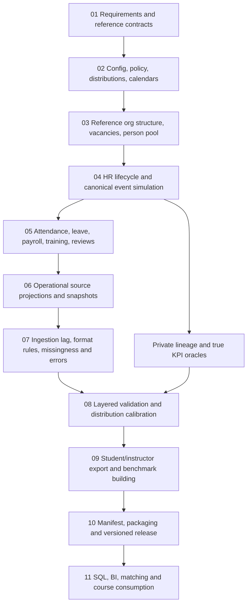

# 03 — End-to-End Data Generation Pipeline

## Overall architecture
This repository is a specification for **the whole journey from a scenario definition to downloadable, validated HR datasets**. Creating a hidden coherent world is necessary but is only stages 3–5; downstream source formatting, noise, QA, release and consumption are first-class phases.

## Stage-by-stage execution
| Phase | Owner/module | Preconditions | Key outputs | Gate |
|---|---|---|---|---|
| 0. Scope | product/schema | named consumers, required sources | profile, table contracts, acceptance criteria | requirements approved |
| 1. Configuration | config/feasibility | versioned YAML and schema | normalized config, immutable seed tree | all targets feasible or explicitly waived |
| 2. Business reference | org/calendar | scale, country/policy scenario | companies, departments, jobs, positions, vacancy demand, calendars | no org cycles/invalid bands |
| 3. Person generation | population | org, locale and privacy assumptions | stable fake persons and optional applicant pool | uniqueness, safe attributes |
| 4. Lifecycle simulation | hiring/employment | person/position/vacancy inventory | applications, stages, joins, episodes, contracts, assignments, exits | state/temporal consistency |
| 5. Operational simulation | attendance/payroll/leave/LMS/performance | active episode intervals, effective policies | event-level work, pay, leave, review, learning records | eligibility/arithmetic |
| 6. Source projection | ATS/HRIS/etc. adapters | coherent canonical history | noiseless rows, source IDs, as-of snapshots, private crosswalk | source contract and provenance |
| 7. Observation imperfections | noise/ingestion | source observations, configured rules | lagged/noisy observations, defect log | source-specific bounds |
| 8. Verification | QA/calibration | all draft artifacts | critical check results, profiles, count reconciliation | blocker checks pass |
| 9. Delivery building | exports/benchmarks | QA-approved run | CSV/Parquet, metadata, labeled/unlabeled pair tasks | separation and schema checks |
| 10. Publishing | release tooling | validated export and full manifest | immutable release package/version | hashes and permissions |

## Data flow rules
- **Generate events in dependency order.** A payroll row is never drawn independently of employment, salary policy, pay period, leave and attendance. A joined application must precede/produce a valid employment start.
- **Stable identity, changing observations.** `person_id` is hidden and stable; ATS candidate, HRIS employee and payroll IDs can differ. A rehire does not overwrite an earlier episode.
- **Temporal model.** Canonical validity intervals are `[valid_from, valid_to)`. `occurred_at` is event time; `recorded_at` is canonical recording time; `observed_at` and `ingested_at` belong to source visibility. `null` end is open-ended.
- **As-of matters.** A department transfer may be historically true from day one while an HRIS extract still shows its previous department because of ingestion delay.
- **Controlled imperfections after coherent projection.** Corrupt observable fields or duplicate source deliveries without editing canonical truth. Retain a private record-to-truth crosswalk, including source row instance identifiers for duplicates.
- **Target calibration does not erase causal logic.** Sample conditional distributions and solve allocation constraints while reporting achieved vs target counts; reject infeasible fixed quotas.
- **Keep teacher answers private.** Separate instructor-only outputs from student files, labels, hints, hidden IDs and secret feature hashes.

## Internal modeling layers
1. **World model**: entities, calendar, policies, positions and active capacity.
2. **Event model**: applications, joining, transfers, pay changes, exits, leave, attendance and payroll.
3. **Source model**: source tables, identifiers, snapshots, ingestion and formatting.
4. **Quality/measurement model**: anomalies, checks, manifests, source-vs-truth KPIs.
5. **Release model**: reproducible artifacts, benchmark tasks, versioning and access control.

The *truth model is Layer 1–2*, not the total product.

## Example of one traceable generated story
A fictional person applies for two roles; the first application is rejected. The second results in an actual join, creating employment episode E1. E1 has an effective assignment and salary, then monthly work schedules, payroll and an approved leave request. A later promotion creates assignment/compensation versions. After exit, a new application and join might create episode E2. The HRIS export may lag promotion by ten days, while Payroll has a corrected paid amount. All source rows point privately to their real generating event/episode; public exports show only operational IDs.

## Dependency policy and parallelism
A module may run in parallel only after all upstream inputs are fixed. Derive deterministic sub-seeds from `(root_seed, module, partition, stable_key)`, not a shared random generator tied to worker order. Sort rows deterministically before export. Snapshot versions, policy versions, and library versions are part of the replay contract.

## Control checkpoints
- **G0:** configuration/schema/targets feasible.
- **G1:** organization/person pool coherent.
- **G2:** lifecycle/event truth and constraints valid.
- **G3:** noiseless operational exports contract-valid.
- **G4:** intentional defects and observation delays are bounded/traceable.
- **G5:** labels/metrics, output package, hashes and privacy release checks pass.

See `15_STAGE_CONTRACTS.md` for exact input/output contracts and `09_QA_VALIDATION.md` for acceptance criteria.
