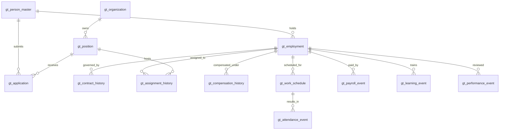

# 04 — Generator Data Model: Canonical, Source and Provenance Schemas

## This model is one layer of the generator
The internal `gt_` tables are **engineering state and measurement oracles** used between population/lifecycle generation and source projection. They should not define the scope of the whole repository. Consumers normally receive source-system exports, not canonical keys. Exact data dictionaries for public exports are described in `06_SOURCE_GENERATION.md` and `02_REFERENCE_AND_INPUTS.md`.

## Three modeling spaces
| Space | Example data | Identity/grain | Visibility |
|---|---|---|---|
| Simulation entities/events | `gt_person_master`, `gt_employment`, `gt_hr_event` | fictitious person / event / episode | restricted |
| Source observations | `Employees.csv`, `Payroll.csv`, `Recruitment.csv` | per HRIS record / payroll period / application | student |
| Measurement and provenance | `gt_source_record_map`, `gt_match_pair_labels`, run manifest | exported row instance / pair / run | restricted or filtered |

## Schema evolution rules
Maintain separate versions for canonical schema, each source schema, and export package. Every new source field must declare type, nullability, allowed values, grain, time semantics, generation rule, noise policy and validation test. New fields in `reference_compatible` mode require an explicit export-version decision, not silent insertion.

## Modeling conventions
All tables below are **new designs proposed for this course generator**, not existing tables in the public reference repository. Canonical IDs are opaque synthetic keys; never export them to student-facing operational CSVs. Use explicit foreign keys, UTC event timestamps, `DATE` intervals with `[start,end)` conventions, and stable reference codes. `null` end means open-ended.

## Mandatory core tables

| Table | Grain / PK | Required fields (in addition to PK) | Important integrity rules |
|---|---|---|---|
| `gt_person_master` | 1 per fictional person; `person_id` | `legal_name`, `date_of_birth`, `preferred_name`, `locale`, `created_at` | identity is stable; names may change through events; no real identifiers |
| `gt_organization` | 1 per org/department node; `organization_id` | `parent_organization_id` nullable, `organization_type`, `name`, `valid_from`, `valid_to` | no org hierarchy cycles; valid parent interval |
| `gt_position` | 1 per approved position; `position_id` | `organization_id`, `job_code`, `grade`, `min_base_salary`, `max_base_salary`, `valid_from`, `valid_to` | valid grade, pay range and owning org |
| `gt_application` | 1 submission; `application_id` | `person_id`, `position_id`, `submitted_at`, `final_outcome`, `finalized_at` nullable | multiple applications/person; one final result/attempt |
| `gt_employment` | 1 continuous episode; `employment_id` | `person_id`, `employer_organization_id`, `start_date`, `end_date` nullable, `source_application_id` nullable, `start_origin` | rehire gets new employment ID; baseline employment can have no modeled ATS application |
| `gt_contract_history` | 1 contractual period; `contract_id` | `employment_id`, `contract_type`, `valid_from`, `valid_to`, `signed_date` | contract within episode or valid pre-start signing; non-overlap unless explicitly amended |
| `gt_assignment_history` | 1 primary assignment interval; `assignment_id` | `employment_id`, `position_id`, `department_id`, `manager_employment_id` nullable, `valid_from`, `valid_to` | primary assignments non-overlapping; manager valid at relevant date |
| `gt_compensation_history` | 1 pay agreement interval; `compensation_id` | `employment_id`, `base_salary`, `currency`, `pay_frequency`, `valid_from`, `valid_to` | valid grade/position policy or documented exception; no unexplained overlapping primary rates |
| `gt_hr_event` | 1 business occurrence; `event_id` | `event_type`, `person_id`, `employment_id` nullable, `application_id` nullable, `occurred_at`, `recorded_at`, `payload_json` | allowed transition; references identify the subject and contextual episode/application |

## Event-based operational truth
| Table | Grain / PK | Important attributes |
|---|---|---|
| `gt_work_schedule` | 1 scheduled employment × work date; `schedule_id` | `employment_id`, `work_date`, `shift_code`, `scheduled_hours`, `work_location`, `calendar_id` |
| `gt_attendance_event` | 1 attendance outcome per schedule; `attendance_event_id` | `schedule_id`, `check_in_at`, `check_out_at`, `attendance_status`, `approved_overtime_hours` |
| `gt_leave_event` | 1 leave request/version; `leave_event_id` | `employment_id`, `requested_at`, `start_date`, `end_date`, `leave_type`, `approval_status`, `decision_at` |
| `gt_payroll_event` | 1 final payroll calculation per episode × period (plus separate amendments); `payroll_event_id` | `employment_id`, `period_start`, `period_end`, `base_pay`, `allowances`, `bonus`, `tax`, `deductions`, `net_pay`, `paid_at`, `payment_kind` |
| `gt_learning_event` | 1 enrollment; `learning_event_id` | `employment_id`, `course_code`, `start_date`, `end_date`, `status`, `cost`, `certificate_awarded` |
| `gt_performance_event` | 1 review; `performance_event_id` | `employment_id`, `review_period_start`, `review_period_end`, `reviewed_at`, `reviewer_employment_id`, `score`, `rating`, `promotion_recommendation` |
| `gt_exit_event` | 1 employment termination event; `exit_event_id` | `employment_id`, `effective_end_date`, `reason_code`, `termination_type`, `notice_days` |

## Benchmark and provenance
| Table | PK / key | Fields |
|---|---|---|
| `gt_source_record_map` | `(run_id, source_name, source_record_id, source_row_instance_id)` | `person_id` nullable, `employment_id` nullable, `application_id` nullable, `truth_event_id` nullable, `source_observed_at`, `projection_version`, `is_intentional_corruption`, `source_row_instance_id` |
| `gt_match_pair_labels` | `(benchmark_version, predicate, left_source, left_record_id, right_source, right_record_id)` | `label` 0/1, `difficulty`, `split`, `rationale_code` |
| `gt_dataset_manifest` | `run_id` | `seed`, `config_hash`, `generator_version`, `schema_version`, `as_of_date`, `file_checksums`, `row_counts`, `validation_summary` |

## Relationship diagram

## Essential cardinality examples
- Person `P00042` may have applications `A001`, `A051`, `A198` and employment episodes `E001`, `E002`.
- `E001` and `E002` can be with different employers, or the same employer after a genuine exit and rehire.
- One episode has many monthly payroll records and many scheduled workdays; payroll or attendance row count is **not** headcount.
- One application may be withdrawn or rejected; no employment episode should be linked to it unless the final event history explicitly explains a superseding valid outcome.
- One position can receive many applications and host different employees at different times.

## Details for implementation decisions
### Employee IDs and multiple employers
Use `person_id` as global identity. Use `employment_id` for employer-specific work periods. `manager_employment_id` should reference a manager episode rather than just a person, so an employee is never incorrectly assigned to a manager who left the organization before the assignment.

### History and current state
The canonical truth is an event ledger plus versioned intervals. “Current employees” and “current department” are **derived as-of views**, not mutable facts replacing history. An HRIS snapshot can have stale information; the truth remains stable.

### Compensation and payroll
Compensation agreements and actual paid payroll are distinct. `net_pay = base_pay + allowances + bonus - tax - deductions` where `base_pay` is the earned pay for that period (which may be prorated); do not confuse monthly earned base pay with contractual monthly base salary.

### Data dictionary completion standard
Each field should ultimately have: type, nullable, unit/currency, semantics, source system, expected distribution, allowed values, join/grain, and generation/validation rule. Expand this specification into machine-readable schema files during implementation.

## Mapping construction and duplicate row instances
Every exported **row instance** must have traceable internal provenance. If an intentional import duplicate repeats the visible `source_record_id`, the physical export row key must be distinguished using a restricted `source_row_instance_id` (or batch sequence) in lineage. The original key `(run_id, source_name, source_record_id)` remains a useful logical key for ordinary unique records but is insufficient as the only key when deliberate same-ID duplicates are allowed. Document the extended mapping and update validations/benchmark endpoint definitions accordingly.
