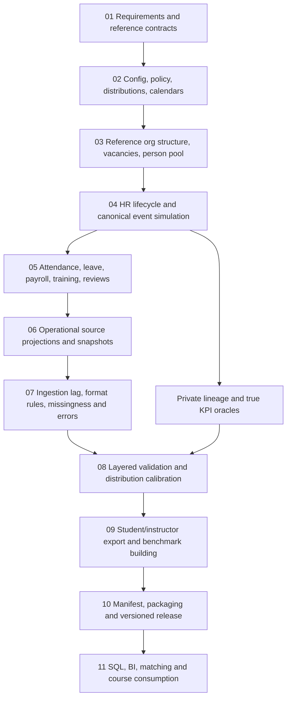
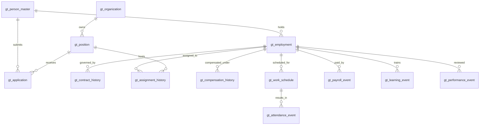

# HR Synthetic Data Generation Lab — Consolidated Knowledge
> Combined `01`–`16` project specifications for ChatGPT Project knowledge. Use this **instead of** separately uploading `01`–`16`. Paste `00_CHATGPT_PROJECT_INSTRUCTIONS.md` into Project instructions separately. This file describes a **proposed** generator, not tested code or existing datasets.

---

<!-- SOURCE: 01_PROJECT_SCOPE.md -->

# 01 — Project Scope, Objectives and Deliverables

## Positioning
**HR Synthetic Data Generation Lab** is an engineering project that specifies and eventually implements a **complete, repeatable data-generation pipeline**, not solely canonical ground-truth creation or data matching. Its outputs are synthetic multi-source HR datasets suitable for data engineering, SQL, analytics, dashboards and entity-resolution learning. Ground truth is an implementation mechanism for consistency, lineage and evaluation.

**End-to-end contract:** `requirements → scenario + distributions → schemas + configuration → organization + population → lifecycle simulation → operational event generation → source projections → lag/noise → QA/calibration → exports/benchmarks → versioned release`.

## Goals and measurable success
| Objective | Expected result | Evidence required |
|---|---|---|
| End-to-end generation | coherent ATS, HRIS, Payroll, Attendance, Leave, Training, Performance and Exit data | generated files with schema/row counts |
| Business realism | plausible conditional outcomes across time, department, tenure and role | distribution, temporal and reconciliation reports |
| Configurability | sizes, periods, policies, rates, noise, output schemas and seeds controllable | validated YAML, scenario snapshots |
| Reproducibility | same config+code+environment+seed gives identical semantic outputs | deterministic tests, canonical hashes |
| Observability | explicit data quality imperfections with private lineage | source profiles, expected anomaly records |
| Analytical usability | documented grains, relational joins, useful HR metrics | dictionary, QA SQL, KPI oracle |
| Evaluation utility | difficult record linkage tasks with reliable hidden answers | benchmark pairs, holdouts, labels |
| Safe distribution | wholly fictional data, audience isolation | privacy and leakage checks |

## What is being generated
1. **Canonical simulation model (private):** fictional people, organizations, jobs, vacancies, applications, contracts, employment episodes, assignment/compensation history, and event ledger.
2. **Operational HR system observations (public/student):** ATS recruitment, HRIS employees, departments and jobs, attendance, payroll, leave, training/LMS, performance, exits.
3. **Optional richer source histories:** stage history, candidate profiles, HRIS assignment/contract history, payroll corrections and ingestion logs.
4. **Supporting artifacts:** schemas, profiles, summary statistics, QA findings, run manifest, scenario assumptions, benchmark tasks, private mapping/labels and KPI oracles.
5. **Learning assets:** SQL/Power BI/KPI examples and instructor assessments (downstream application, not a prerequisite for generating data).

## Default fictional scenario
- Vietnam-localized fictional employer group; `vi_VN`, VND and `Asia/Ho_Chi_Minh` are default assumptions, not mandatory settings.
- Reporting window: `2020-01-01` to `2025-08-31` inclusive; any current/partial-year comparison must acknowledge the cutoff.
- Reference-inspired **targets**: 8,000 fictional persons in the pool; 9,000 applications; 1,081 employment episodes already active at the window's start; 1,919 joins during the period; 929 exits by the cutoff; 3,000 total episodes and 2,071 active episodes **only if** the configured feasibility and event accounting hold.
- Multiple applications per person, transfer/promotion, rehire and manager changes should occur. A rehire creates a new `employment_id` for the same `person_id`.
- Target counts are not evidence of produced data. An engine must report achieved counts, violations and deviations rather than silently modifying reality to fit totals.

## Audience and deliverable separation
| Area | Audience | Examples | Must not contain |
|---|---|---|---|
| `output/<run_id>/student/raw/` | analysts/students | ten source CSVs | canonical IDs, labels |
| `output/<run_id>/student/extended/` | advanced learners | source histories, optional candidate pairs | answer keys |
| `output/<run_id>/instructor/truth/` | restricted | canonical Parquet/event history | real personal data |
| `output/<run_id>/instructor/benchmarks/` | restricted | mapping and labeled matching tasks | public exposure |
| `output/<run_id>/metadata/` | controlled | run manifest, profiles, schema docs, QA | instructor secrets in shared bundle |

## In scope / outside scope
**In scope:** design-to-export simulation, HR workflow coherence, versioned source formats, configurable controlled source imperfections, target tuning, quality assurance, release packaging, and analytics-oriented evaluation.

**Out of scope initially:** live HR APIs, legally compliant payroll taxation, labor-law advice, actual employee data, genuine performance prediction, credit/medical/biometric attributes, production identity verification, and real-world predictive claims.

## Delivery sequence
- **D0 — specification:** this Markdown pack and explicitly documented assumptions.
- **D1 — executable smoke:** 100-person deterministic fixture with five source CSVs, hidden mapping, tests and manifest.
- **D2 — full HR generation:** configurable simulation with 10 reference-compatible files and extended histories; measured QA and KPI oracles.
- **D3 — scenario/benchmark release:** multiple difficulty profiles, matching pairs, instructor release, documentation and grading utilities.

Read `03_END_TO_END_PIPELINE.md`, `07_SCENARIO_CONFIG.md`, `14_IMPLEMENTATION_ROADMAP.md` and `15_STAGE_CONTRACTS.md` before implementation.

---

<!-- SOURCE: 02_REFERENCE_AND_INPUTS.md -->

# 02 — Reference Repository, Input Assumptions and Compatibility

## Role of external reference in the end-to-end project
The repository below informs desired table names, SQL/Power BI compatibility, and example reporting scope. **It is not a requirements authority for random seeds, synthetic distributions, canonical data, noise rules, or expected generated counts.** Those originate from this lab's own scenario/configuration and must be validated at execution.

### Input/assumption inventory
| Input | Origin | Used by stage | Verification |
|---|---|---|---|
| SQL reference table names and column examples | public sample repository | export adapter | compare actual headers/SQL types |
| Fictional Vietnamese locale and reporting range | local scenario | people/calendar/business events | parse dates and safe locales |
| HR probabilities and outcomes | `07_SCENARIO_CONFIG.md` | event simulators | feasible eligibility + achieved distribution |
| Job/grade/pay bands | generated org catalog | position/compensation | valid bounds and dependencies |
| Source-specific lag/noise | scenario rules | projection and corruption | traceable transformation log |

Maintain a **compatibility matrix** rather than forcing the internal simulation schema to inherit reference-system modeling limitations.

## Verified reference
Repository: https://github.com/vikashGiri27/HR-Analytics-end-to-end-project

Checked against its public `README.md`, root `Database/` directory, and `Database/HR_Database_Setup.sql` on the default `main` branch on 2026-10-31. The reference uses MySQL, SQL/advanced SQL, Power BI, DAX, and Power Query. Its four dashboard pages are overview, recruitment/hiring, retention/attrition, and performance. It describes 2025 reporting as partial through August.

**This is a reference analytics repository, not our generator implementation.** Its existing CSV files do not establish a canonical identity or employee-lifecycle ground truth. The proposed tables prefixed with `gt_` in this kit are new.

## Existing table contracts from reference MySQL setup
| Reference table | Important fields (subset, exact spelling follows SQL setup) | Proposed observation grain |
|---|---|---|
| `employees` | `Employee_ID`, `First_Name`, `Last_Name`, `Hire_Date`, `Department_ID`, `Job_ID`, `Manager_ID`, `Employment_Status`, `Salary` | one HRIS employee/episode snapshot or versioned record |
| `departments` | `Department_ID`, `Department_Name`, `Location`, `Budget`, `Head_Employee_ID` | department snapshot |
| `jobs` | `Job_ID`, `Job_Title`, `Grade`, `Minimum_Salary`, `Maximum_Salary` | job reference |
| `recruitment` | `Recruitment_ID`, `Candidate_ID`, `Candidate_Name`, `Position`, `Department_ID`, `Application_Date`, `Interview_Date`, `Recruiter_ID`, `Hiring_Status`, `Joining_Date` | one application |
| `attendance` | `Attendance_ID`, `Employee_ID`, `Attendance_Date`, `Check_In`, `Check_Out`, `Working_Hours`, `Overtime_Hours`, `Attendance_Status`, `Shift` | employee × scheduled date |
| `payroll` | `Payroll_ID`, `Employee_ID`, `Payroll_Month`, `Basic_Salary`, `Allowances`, `Bonus`, `Tax`, `Deductions`, `Net_Salary`, `Payment_Date` | employment × payroll period |
| `leave_data` | `Leave_ID`, `Employee_ID`, `Leave_Type`, `Start_Date`, `End_Date`, `Total_Days`, `Approval_Status` | leave request |
| `training` | `Training_ID`, `Employee_ID`, `Training_Name`, `Provider`, `Start_Date`, `End_Date`, `Training_Cost`, `Certification_Status` | training enrollment |
| `performance` | `Performance_ID`, `Employee_ID`, `Review_Date`, `Reviewer_ID`, `KPI_Score`, `Productivity_Score`, `Attendance_Score`, `Teamwork_Score`, `Overall_Rating`, `Promotion_Recommendation` | performance review |
| `exit_data` | `Exit_ID`, `Employee_ID`, `Exit_Date`, `Exit_Reason`, `Exit_Type`, `Notice_Period`, `Final_Rating` | exit event |

The SQL setup has `exit_data.Employee_ID` marked unique, which limits it to one exit per *observed employee ID*. For rehiring in the new generator, either assign a new source `Employee_ID` per employment episode or use an extended versioned schema. A person can therefore have several HRIS IDs/episodes.

## Two output modes
### Mode A — `reference_compatible`
Export ten CSV files using the reference naming, column names, and MySQL-friendly types. Preserve the relationships expected by its SQL/DAX approach. Do not silently append `person_id`, `employment_id`, or ground-truth labels. Source IDs remain source-specific. Keep schemas compatible with the reference SQL where practical.

### Mode B — `extended_multisource`
Add ATS candidate profiles, interview stages, HRIS history, contract changes, org moves, source ingestion timestamps, as-of snapshots, source provenance and versioned public records. Extra files are additive, not assumed to exist in the GitHub repository.

## Important analytical differences
- The reference README describes `3,000` workforce records, `2,071` active, `929` exits, and `9,000` applications. Treat them as reference dashboard figures, not hard-coded statistical truths of a newly simulated world.
- Its `31%` attrition dashboard value appears to be a ratio of exits to the stated workforce count; for the course use a period-specific **attrition rate** with a properly defined denominator.
- `Recruitment_ID`, `Candidate_ID`, and `Employee_ID` must not be interpreted as canonical person identifiers.
- `Joining_Date` must correspond to an eligible joined application and employment episode; an offer or acceptance without a start is not a hire in a join-based metric.
- A current-state `employees` table can conceal past team/manager changes. Teach history through canonical assignment events and an optional versioned HRIS source.
- The README and SQL file are sufficient to align schemas, but no claim is made that original CSV distributions or embedded PBIX calculations were fully audited.

## License and attribution
Do not copy or redistribute the repository's original data, images, or SQL wholesale without checking its license and permissions. The synthetic generator should create new, independent fictional records and reference the project for educational inspiration.

## Implementation decision record
Choose compatibility mode explicitly for each release. Never put new private fields into the ten reference CSV files. Unsupported reference assumptions (such as uniqueness of source Employee_ID across rehire) must be solved through source episode IDs and additive history files, not by modifying historical truth.

---

<!-- SOURCE: 03_END_TO_END_PIPELINE.md -->

# 03 — End-to-End Data Generation Pipeline

## Overall architecture
This repository is a specification for **the whole journey from a scenario definition to downloadable, validated HR datasets**. Creating a hidden coherent world is necessary but is only stages 3–5; downstream source formatting, noise, QA, release and consumption are first-class phases.



## Stage-by-stage execution
| Phase | Owner/module | Preconditions | Key outputs | Gate |
|---|---|---|---|---|
| 0. Scope | product/schema | named consumers, required sources | profile, table contracts, acceptance criteria | requirements approved |
| 1. Configuration | config/feasibility | versioned YAML and schema | normalized config, immutable seed tree | all targets feasible or explicitly waived |
| 2. Business reference | org/calendar | scale, country/policy scenario | companies, departments, jobs, positions, vacancy demand, calendars | no org cycles/invalid bands |
| 3. Person generation | population | org, locale and privacy assumptions | stable fake persons and optional applicant pool | uniqueness, safe attributes |
| 4. Lifecycle simulation | hiring/employment | person/position/vacancy inventory | applications, stages, joins, episodes, contracts, assignments, exits | state/temporal consistency |
| 5. Operational simulation | attendance/payroll/leave/LMS/performance | active episode intervals, effective policies | event-level work, pay, leave, review, learning records | eligibility/arithmetic |
| 6. Source projection | ATS/HRIS/etc. adapters | coherent canonical history | noiseless rows, source IDs, as-of snapshots, private crosswalk | source contract and provenance |
| 7. Observation imperfections | noise/ingestion | source observations, configured rules | lagged/noisy observations, defect log | source-specific bounds |
| 8. Verification | QA/calibration | all draft artifacts | critical check results, profiles, count reconciliation | blocker checks pass |
| 9. Delivery building | exports/benchmarks | QA-approved run | CSV/Parquet, metadata, labeled/unlabeled pair tasks | separation and schema checks |
| 10. Publishing | release tooling | validated export and full manifest | immutable release package/version | hashes and permissions |

## Data flow rules
- **Generate events in dependency order.** A payroll row is never drawn independently of employment, salary policy, pay period, leave and attendance. A joined application must precede/produce a valid employment start.
- **Stable identity, changing observations.** `person_id` is hidden and stable; ATS candidate, HRIS employee and payroll IDs can differ. A rehire does not overwrite an earlier episode.
- **Temporal model.** Canonical validity intervals are `[valid_from, valid_to)`. `occurred_at` is event time; `recorded_at` is canonical recording time; `observed_at` and `ingested_at` belong to source visibility. `null` end is open-ended.
- **As-of matters.** A department transfer may be historically true from day one while an HRIS extract still shows its previous department because of ingestion delay.
- **Controlled imperfections after coherent projection.** Corrupt observable fields or duplicate source deliveries without editing canonical truth. Retain a private record-to-truth crosswalk, including source row instance identifiers for duplicates.
- **Target calibration does not erase causal logic.** Sample conditional distributions and solve allocation constraints while reporting achieved vs target counts; reject infeasible fixed quotas.
- **Keep teacher answers private.** Separate instructor-only outputs from student files, labels, hints, hidden IDs and secret feature hashes.

## Internal modeling layers
1. **World model**: entities, calendar, policies, positions and active capacity.
2. **Event model**: applications, joining, transfers, pay changes, exits, leave, attendance and payroll.
3. **Source model**: source tables, identifiers, snapshots, ingestion and formatting.
4. **Quality/measurement model**: anomalies, checks, manifests, source-vs-truth KPIs.
5. **Release model**: reproducible artifacts, benchmark tasks, versioning and access control.

The *truth model is Layer 1–2*, not the total product.

## Example of one traceable generated story
A fictional person applies for two roles; the first application is rejected. The second results in an actual join, creating employment episode E1. E1 has an effective assignment and salary, then monthly work schedules, payroll and an approved leave request. A later promotion creates assignment/compensation versions. After exit, a new application and join might create episode E2. The HRIS export may lag promotion by ten days, while Payroll has a corrected paid amount. All source rows point privately to their real generating event/episode; public exports show only operational IDs.

## Dependency policy and parallelism
A module may run in parallel only after all upstream inputs are fixed. Derive deterministic sub-seeds from `(root_seed, module, partition, stable_key)`, not a shared random generator tied to worker order. Sort rows deterministically before export. Snapshot versions, policy versions, and library versions are part of the replay contract.

## Control checkpoints
- **G0:** configuration/schema/targets feasible.
- **G1:** organization/person pool coherent.
- **G2:** lifecycle/event truth and constraints valid.
- **G3:** noiseless operational exports contract-valid.
- **G4:** intentional defects and observation delays are bounded/traceable.
- **G5:** labels/metrics, output package, hashes and privacy release checks pass.

See `15_STAGE_CONTRACTS.md` for exact input/output contracts and `09_QA_VALIDATION.md` for acceptance criteria.

---

<!-- SOURCE: 04_DATA_MODEL.md -->

# 04 — Generator Data Model: Canonical, Source and Provenance Schemas

## This model is one layer of the generator
The internal `gt_` tables are **engineering state and measurement oracles** used between population/lifecycle generation and source projection. They should not define the scope of the whole repository. Consumers normally receive source-system exports, not canonical keys. Exact data dictionaries for public exports are described in `06_SOURCE_GENERATION.md` and `02_REFERENCE_AND_INPUTS.md`.

## Three modeling spaces
| Space | Example data | Identity/grain | Visibility |
|---|---|---|---|
| Simulation entities/events | `gt_person_master`, `gt_employment`, `gt_hr_event` | fictitious person / event / episode | restricted |
| Source observations | `Employees.csv`, `Payroll.csv`, `Recruitment.csv` | per HRIS record / payroll period / application | student |
| Measurement and provenance | `gt_source_record_map`, `gt_match_pair_labels`, run manifest | exported row instance / pair / run | restricted or filtered |

## Schema evolution rules
Maintain separate versions for canonical schema, each source schema, and export package. Every new source field must declare type, nullability, allowed values, grain, time semantics, generation rule, noise policy and validation test. New fields in `reference_compatible` mode require an explicit export-version decision, not silent insertion.

## Modeling conventions
All tables below are **new designs proposed for this course generator**, not existing tables in the public reference repository. Canonical IDs are opaque synthetic keys; never export them to student-facing operational CSVs. Use explicit foreign keys, UTC event timestamps, `DATE` intervals with `[start,end)` conventions, and stable reference codes. `null` end means open-ended.

## Mandatory core tables

| Table | Grain / PK | Required fields (in addition to PK) | Important integrity rules |
|---|---|---|---|
| `gt_person_master` | 1 per fictional person; `person_id` | `legal_name`, `date_of_birth`, `preferred_name`, `locale`, `created_at` | identity is stable; names may change through events; no real identifiers |
| `gt_organization` | 1 per org/department node; `organization_id` | `parent_organization_id` nullable, `organization_type`, `name`, `valid_from`, `valid_to` | no org hierarchy cycles; valid parent interval |
| `gt_position` | 1 per approved position; `position_id` | `organization_id`, `job_code`, `grade`, `min_base_salary`, `max_base_salary`, `valid_from`, `valid_to` | valid grade, pay range and owning org |
| `gt_application` | 1 submission; `application_id` | `person_id`, `position_id`, `submitted_at`, `final_outcome`, `finalized_at` nullable | multiple applications/person; one final result/attempt |
| `gt_employment` | 1 continuous episode; `employment_id` | `person_id`, `employer_organization_id`, `start_date`, `end_date` nullable, `source_application_id` nullable, `start_origin` | rehire gets new employment ID; baseline employment can have no modeled ATS application |
| `gt_contract_history` | 1 contractual period; `contract_id` | `employment_id`, `contract_type`, `valid_from`, `valid_to`, `signed_date` | contract within episode or valid pre-start signing; non-overlap unless explicitly amended |
| `gt_assignment_history` | 1 primary assignment interval; `assignment_id` | `employment_id`, `position_id`, `department_id`, `manager_employment_id` nullable, `valid_from`, `valid_to` | primary assignments non-overlapping; manager valid at relevant date |
| `gt_compensation_history` | 1 pay agreement interval; `compensation_id` | `employment_id`, `base_salary`, `currency`, `pay_frequency`, `valid_from`, `valid_to` | valid grade/position policy or documented exception; no unexplained overlapping primary rates |
| `gt_hr_event` | 1 business occurrence; `event_id` | `event_type`, `person_id`, `employment_id` nullable, `application_id` nullable, `occurred_at`, `recorded_at`, `payload_json` | allowed transition; references identify the subject and contextual episode/application |

## Event-based operational truth
| Table | Grain / PK | Important attributes |
|---|---|---|
| `gt_work_schedule` | 1 scheduled employment × work date; `schedule_id` | `employment_id`, `work_date`, `shift_code`, `scheduled_hours`, `work_location`, `calendar_id` |
| `gt_attendance_event` | 1 attendance outcome per schedule; `attendance_event_id` | `schedule_id`, `check_in_at`, `check_out_at`, `attendance_status`, `approved_overtime_hours` |
| `gt_leave_event` | 1 leave request/version; `leave_event_id` | `employment_id`, `requested_at`, `start_date`, `end_date`, `leave_type`, `approval_status`, `decision_at` |
| `gt_payroll_event` | 1 final payroll calculation per episode × period (plus separate amendments); `payroll_event_id` | `employment_id`, `period_start`, `period_end`, `base_pay`, `allowances`, `bonus`, `tax`, `deductions`, `net_pay`, `paid_at`, `payment_kind` |
| `gt_learning_event` | 1 enrollment; `learning_event_id` | `employment_id`, `course_code`, `start_date`, `end_date`, `status`, `cost`, `certificate_awarded` |
| `gt_performance_event` | 1 review; `performance_event_id` | `employment_id`, `review_period_start`, `review_period_end`, `reviewed_at`, `reviewer_employment_id`, `score`, `rating`, `promotion_recommendation` |
| `gt_exit_event` | 1 employment termination event; `exit_event_id` | `employment_id`, `effective_end_date`, `reason_code`, `termination_type`, `notice_days` |

## Benchmark and provenance
| Table | PK / key | Fields |
|---|---|---|
| `gt_source_record_map` | `(run_id, source_name, source_record_id, source_row_instance_id)` | `person_id` nullable, `employment_id` nullable, `application_id` nullable, `truth_event_id` nullable, `source_observed_at`, `projection_version`, `is_intentional_corruption`, `source_row_instance_id` |
| `gt_match_pair_labels` | `(benchmark_version, predicate, left_source, left_record_id, right_source, right_record_id)` | `label` 0/1, `difficulty`, `split`, `rationale_code` |
| `gt_dataset_manifest` | `run_id` | `seed`, `config_hash`, `generator_version`, `schema_version`, `as_of_date`, `file_checksums`, `row_counts`, `validation_summary` |

## Relationship diagram



## Essential cardinality examples
- Person `P00042` may have applications `A001`, `A051`, `A198` and employment episodes `E001`, `E002`.
- `E001` and `E002` can be with different employers, or the same employer after a genuine exit and rehire.
- One episode has many monthly payroll records and many scheduled workdays; payroll or attendance row count is **not** headcount.
- One application may be withdrawn or rejected; no employment episode should be linked to it unless the final event history explicitly explains a superseding valid outcome.
- One position can receive many applications and host different employees at different times.

## Details for implementation decisions
### Employee IDs and multiple employers
Use `person_id` as global identity. Use `employment_id` for employer-specific work periods. `manager_employment_id` should reference a manager episode rather than just a person, so an employee is never incorrectly assigned to a manager who left the organization before the assignment.

### History and current state
The canonical truth is an event ledger plus versioned intervals. “Current employees” and “current department” are **derived as-of views**, not mutable facts replacing history. An HRIS snapshot can have stale information; the truth remains stable.

### Compensation and payroll
Compensation agreements and actual paid payroll are distinct. `net_pay = base_pay + allowances + bonus - tax - deductions` where `base_pay` is the earned pay for that period (which may be prorated); do not confuse monthly earned base pay with contractual monthly base salary.

### Data dictionary completion standard
Each field should ultimately have: type, nullable, unit/currency, semantics, source system, expected distribution, allowed values, join/grain, and generation/validation rule. Expand this specification into machine-readable schema files during implementation.

## Mapping construction and duplicate row instances
Every exported **row instance** must have traceable internal provenance. If an intentional import duplicate repeats the visible `source_record_id`, the physical export row key must be distinguished using a restricted `source_row_instance_id` (or batch sequence) in lineage. The original key `(run_id, source_name, source_record_id)` remains a useful logical key for ordinary unique records but is insufficient as the only key when deliberate same-ID duplicates are allowed. Document the extended mapping and update validations/benchmark endpoint definitions accordingly.

---

<!-- SOURCE: 05_HR_EVENT_SIMULATION.md -->

# 05 — HR Event Simulation and Business Rules

## Generation dependency, not just the state machine
This file defines the **HR business simulator** in phases 4–5 of the end-to-end pipeline: positions/vacancies must exist first; applications may lead to joins; employment creates eligibility for work, payroll, leave, reviews and exits; source exports come afterward. State machines protect causal consistency; distributions in `07_SCENARIO_CONFIG.md` determine *how often* valid transitions occur.

## Conditional simulation knobs
| Process | Draw depends on | Examples of constraints |
|---|---|---|
| Vacancy creation | org growth, approved positions, role and season | capacity/grade consistency |
| Applicant arrival | vacancy age, role, recruiting seasonality | application timestamp in window |
| Stage progression | role, candidate pool, configured stage rates | order of stages and no impossible joins |
| Offer/no-show | candidate stage, open position, start-date availability | accepted offer need not lead to join |
| Transfer/promotion | tenure, assignment, org eligibility | close old assignment, keep episode |
| Exit / rehire | tenure, company, season, policy | new episode on rehire, no same-employer overlap by default |
| Schedule/attendance | work calendar, leave, start/end, shift | no ordinary schedule outside active episode |
| Payroll | earned work, compensation intervals, period policy | prorating and reconciled net pay |
| Training/reviews | eligibility, tenure, job, team | review period and reviewer validity |

All probabilities are synthetic design choices, not evidence about real worker behavior or protected populations.

## State machines
### Candidate/application
`SUBMITTED → SCREENING → INTERVIEW → OFFERED → ACCEPTED → JOINED`, with allowed terminal alternatives `REJECTED`, `WITHDRAWN`, `CANCELLED`, or `NO_SHOW`. `ON_HOLD` is an intermediate state that can later resume. **Only `JOINED` creates a started employment episode.** The presence of an offer or accepted offer alone is not sufficient.

### Employment episode
`PLANNED → ACTIVE → EXITED`, with optional pre-start `CANCELLED`. Rehire is **not** `EXITED → ACTIVE` on the same `employment_id`; create a new episode associated with the same `person_id` after a new join event. Moves, promotion, probation completion, parental leave and temporary absence change attributes or availability without creating a new episode.

### Contract and assignment
An active episode can contain multiple sequential contract versions, compensation intervals and primary job assignments. A transfer closes the previous assignment interval and opens the next; it does not rewrite an old department in historical records.

## Allowed causal dependencies
| Event | Required precondition | Required effect |
|---|---|---|
| `application_submitted` | candidate and open position exist | application record created |
| `application_joined` | successful candidate process, actual start date | `gt_employment` episode created |
| `employment_started` | effective start, eligible assignment/contract | payroll and work schedule eligibility begins |
| `contract_renewed` | existing valid episode | new contractual interval, previous version closed |
| `promoted` / `transferred` | episode active | new assignment, optionally new compensation interval |
| `manager_changed` | both relevant episodes active and valid | new manager assignment interval |
| `leave_approved` | eligible active episode, leave interval valid | schedule/absence state reflects leave |
| `employment_ended` | episode active | episode closes; subsequent routine schedules stop |
| `rehired` | a genuine earlier exit, new start | new employment ID linked to same person |

## Mandatory temporal invariants
1. `application.submitted_at <= interview_at <= offer_at <= joined_at` for stages that occur; do not require skipped optional stages.
2. For a joined in-window application, `employment.start_date = actual_join_date`, with separate planned vs actual dates.
3. `employment.end_date > employment.start_date` using exclusive-end convention.
4. Contracts and assignments must not create a primary work relationship outside the episode. Pre-start signing may occur before start, but validity starts no earlier than the employment start unless explicitly designed otherwise.
5. The combination `(employment_id, work_date)` should have at most one primary schedule; no ordinary scheduled work after episode end.
6. Overtime is conditional on attendance and approved rules; absence is not simultaneously coded as normal onsite presence except a documented split-day case.
7. Monthly payroll is produced only for periods overlapping an eligible episode; prorate starts and ends. Final payment or adjustment after exit is allowed if `payment_kind` makes the relationship explicit.
8. A review's `reviewed_at` must not precede the work/assessment period, and its reviewer must be valid as of the relevant event; allow documented external or late review corrections separately.
9. A manager relationship cannot create a management cycle, including via transfers and manager rehires.
10. Concurrent employment is disabled by default for a single employer, though multi-company concurrent episodes can be introduced as a controlled scenario.
11. Source ingestion can lag behind the effective event; this creates **staleness**, not a change in canonical truth.

## Worked fictional lifecycle
| Date | Canonical event | Entity effect |
|---|---|---|
| 2022-01-01 | Starts Company A | `P00042`, episode `E001` |
| 2024-06-30 | Final active workday at Company A | `E001` has exclusive `end_date=2024-07-01` |
| 2025-03-10 | Applies for Data Analyst, Company B | application `A0098` |
| 2025-04-15 | Accepted offer | application pending start |
| 2025-05-01 | Starts Company B | new episode `E002`, linked to `P00042` |
| 2025-08-10 | SQL course completed | learning event belongs to `E002` |
| 2025-08-31 | As-of reporting date | `E002` active |

**Identity predicates:** `SAME_PERSON(E001,E002)=1`; `SAME_EMPLOYMENT(E001,E002)=0`; `SAME_COMPANY(E001,E002)=0` if these episodes belong to different companies.

## Realism scenarios worth simulating
- Candidate applies three times; only the third application leads to a join.
- Employee transfers from Sales to Finance in July; June payroll attributes costs to Sales under the selected accounting rule.
- Promotion changes grade/salary effective on the first day of a month, but HRIS updates 10 days later.
- Employee resigns then rejoins the same employer after six months with a new HRIS ID.
- A rejected applicant has a highly similar name to a different successful employee.
- Payroll amendment arrives after termination; it is not a new period of employment.
- Leave overlaps a public holiday; count chargeable leave days using the applicable work calendar, not just date subtraction.

## Scenario-specific law and policy
Contract categories, holidays, tax parameters, maximum working hours, termination notices, and overtime formulas vary by geography and date. The generator's default rules are **fictional training assumptions** and must be labeled as such. Do not claim legal compliance with Vietnam or any other jurisdiction without independent legal validation.

## Simulator design contract
For each event family, implement `eligible(state, date)`, `sample_transition(context, rng)`, `apply(event, state)`, `validate(event, before, after)` and `emit_truth_rows(event)`. Support deterministic replay and correction events without silently editing already-exported source facts. Provide tests for skipped optional recruiting stages, final-pay adjustments, backdated changes and partially observed reporting windows.

---

<!-- SOURCE: 06_SOURCE_GENERATION.md -->

# 06 — Multi-Source HR Data Generation and Export Contracts

## Why source generation is a distinct phase
A source adapter converts one coherent simulated HR world into an **operational system's view**, including its PKs, status vocabulary, snapshot date and ingestion behavior. It must never generate unrelated rows from scratch. Every adapter declares source-specific schema, input event families, primary grain, record-ID policy, observation cutoff and allowed absence/duplicate rules.

## End-to-end adapter API (conceptual)
```python
# Interface proposal, not executable code from an existing package.
class SourceAdapter:
    source_name: str
    schema_version: str
    def project(self, truth, as_of, config, rng): ...  # noiseless source rows + lineage
    def validate_clean(self, rows, crosswalk): ...
    def export(self, rows, output_mode): ...
```

## Generate count expectations from grain
For monthly payroll, expected base volume is the number of **eligible employment-episode × pay periods**, not `n_employees * fixed_months`. For attendance, expected volume comes from generated schedules, holidays, leave and active dates. For performance, use tenure/review eligibility. Record row counts per stage: ideal event count → clean projected count → noisy exported count.

## Fundamental rule
Each operational dataset is a **projection** of the canonical world at a specified observation time. The student's records use source-specific IDs. The generator maintains a separate, inaccessible mapping to canonical IDs. Granularity is explicit and stable.

## Source contracts
| Source | Student-facing table / file | Grain and observed primary key | Generated from | Key projection behavior |
|---|---|---|---|---|
| ATS | `Recruitment.csv` | application / `Recruitment_ID` | applications and application events | multiple applications per person, candidate name variants, withdrawn/rejected/on-hold states |
| HRIS | `Employees.csv` | episode snapshot / `Employee_ID` | employment, assignment, contracts, personal identity | one new Employee_ID per episode; current department/job/manager as-of snapshot; stale updates possible |
| Organization | `Departments.csv` | department / `Department_ID` | `gt_organization` | names, heads, budget, location; valid at snapshot |
| Job catalog | `Jobs.csv` | job / `Job_ID` | `gt_position`/job codes | grade and salary range references |
| Attendance | `Attendance.csv` | scheduled episode × date / `Attendance_ID` | schedules and attendance events | check-in/out, absences, overtime; weekends depend on calendar |
| Payroll | `Payroll.csv` | episode × pay period / `Payroll_ID` | compensation, eligibility, payroll events | correct prorating, earnings and deductions, payment timing |
| Leave | `Leave.csv` | leave request / `Leave_ID` | leave events | requested vs approved leave and holiday-aware chargeable duration |
| LMS | `Training.csv` | course enrollment / `Training_ID` | learning events | start/end, certification, cost and completion |
| Performance | `Performance.csv` | performance review / `Performance_ID` | performance events | reviewer relation, scores, recommendation, review timing |
| Exit | `Exit.csv` | exit event / `Exit_ID` | exit events | termination per episode, reason/type/notice period |

The above ten legacy-compatible tables mirror the **table set** in the reference repository; the generator's canonical model and matching files are proposed additions.

## Compatibility field rules
For `reference_compatible`, use **exact column names** from `02_REFERENCE_AND_INPUTS.md` and preserve appropriate column order when exporting to reference-shaped CSV. Some references use `Exit.csv` while their SQL table is `exit_data`, and `Leave.csv` maps to `leave_data`: document these translations in a machine-readable export manifest.

Critical mappings:
- `ATS.Recruitment_ID` → internal `application_id`; `Candidate_ID` is an **ATS-local** candidate profile key and can recur across that candidate's applications. Never assume Candidate_ID identifies the same person across systems or across ATS migrations.
- `HRIS.Employee_ID` → internal `employment_id` via mapping; two episodes of one person receive distinct IDs for compatibility.
- `Payroll.Employee_ID`, `Attendance.Employee_ID`, `Training.Employee_ID`, etc. should reference the **observed HRIS Employee_ID** valid for the episode when the source has a trusted internal integration. For harder matching exercises, configure some sources with their own employee identifiers and a secure crosswalk instead.
- `HRIS.Manager_ID` maps to the source Employee_ID of a manager whose **assignment is effective as-of the source snapshot**. If the manager record lags, simulate a bounded mismatch.
- `Employee.Hire_Date` represents episode start, not the person's first-ever hire date.
- `Employees.Salary` represents the designated as-of contractual rate; `Payroll.Basic_Salary` represents earned base pay for a specific period, which may be prorated.
- Use `Recruitment.Hiring_Status = 'Hired'` in compatibility mode **only after actual joining**, not merely offer acceptance.

## Recommended extended exports
For richer teaching, generate separate additive files rather than quietly changing the legacy schema:
- `ATS_Candidates.csv`: candidate profile versions with updated contact details.
- `ATS_Stages.csv`: stage history and timestamps per application.
- `HRIS_Employment_History.csv`: episode starts/exits, employee IDs, effective and recorded times.
- `HRIS_Assignment_History.csv`: department/job/manager as-of intervals.
- `HRIS_Contract_History.csv`: contract versions, types and effective dates.
- `Payroll_Adjustments.csv`: final pay, retroactive corrections, bonuses after exit.
- `Source_Ingestion_Log.csv`: source update delay, batches and incomplete transmissions.

## Example source observations (illustrative; not generated records)
| Source | Observed ID | Observed name | Internal truth link (instructor only) |
|---|---|---|---|
| ATS | APP0098 | Nguyen Thi Minh Anh | `person=P00042`, `application=A0098` |
| HRIS | EMP0031 | Nguyễn Thị Minh Anh | `person=P00042`, `employment=E002` |
| Payroll | PAY0081 | NGUYEN THI MINH ANH | `person=P00042`, `employment=E002` |
| Attendance | ATT0152 | Nguyễn T. M. Anh | `person=P00042`, `employment=E002` |

**Never include the right-hand truth-link column in student exports.** The table exists only to explain provenance to instructors and implementers.

## Row-count rules
- `count(recruitment)` = number of applications, **not** unique candidates.
- `count(employees)` = count of episode snapshots in legacy mode, **not** distinct people when rehires occur.
- `count(payroll)` ≈ number of eligible episode-months, plus separately classified adjustments if exported.
- `count(attendance)` = scheduled episode-days that emit observed records, not number of people or calendar days.
- `count(training)` = learning enrollments, including repeats by different employees.
- `count(exit_data)` = terminated episodes visible by the as-of date.

## Visibility filters
Export source snapshots using `source_observed_at` and `ingested_at` cutoffs. A canonical transfer on June 1 may not appear in an HRIS export taken on June 3 if its update is ingested on June 8. Do not rewrite canonical June history to imitate this delay.

## Cross-source consistency and intentional errors
Keep the noiseless projections referentially and temporally valid. Apply controlled source-specific errors afterward and record intentional errors with reason codes. A source mismatch should normally remain plausible and traceable; an arbitrary impossible birthdate or random employee ID is not a useful realism shortcut.

## Public row visibility after noise
All source outputs must be produced in this order: (1) canonical eligible events → (2) source-schema projection → (3) source IDs/crosswalk → (4) visible ingestion snapshot → (5) allowed formatting/staleness/missingness/duplicate rules → (6) source QA and role-safe release. A truncated snapshot is not the same as random record deletion; report both separately.

---

<!-- SOURCE: 07_SCENARIO_CONFIG.md -->

# 07 — End-to-End Scenario Configuration, Distributions and Targets

## Config is the control plane for the whole pipeline
The YAML below determines **data generation**, not simply truth-table size: entities, time horizons, event probabilities, source views, quality defects, matching scenarios and file outputs. It is an example contract and must not be presented as generated data or tested software.

### Config lifecycle
1. Parse and validate types/enums/units; normalize dates, locales, rates and output modes.
2. Check feasibility of exact counts and conditional rates (vacancy capacity, eligibility windows, active-headcount accounting).
3. Create a stable, ordered scenario snapshot and content hash; derive sub-seeds by module/stable key.
4. Resolve effective business policies and freeze them for the run.
5. Generate components in dependency order, collecting achieved counts/diagnostics after each stage.
6. Export both intended targets and realized values; never claim a percentage target was satisfied without tolerance checks.

### Parameter ownership
| Parameter group | Owner | Affects |
|---|---|---|
| `period`, `population` | scenario | population, episodes, truncation |
| `recruitment`, `employment` | domain simulation | application/stage/join/exit transitions |
| `attendance`, `payroll`, `training`, `performance` | operational simulators | work schedules, compensation, learning, reviews |
| `observation` | source projection | as-of visibility and source delays |
| `noise` | quality injection | exported defects and missingness |
| `benchmark` | measurement | pair sampling, splits and labels |
| `exports` | delivery | CSV/Parquet, manifests and release boundaries |

## Approach
Every run accepts a declarative configuration. The YAML below is a **proposed generator contract**; it is not a claim that software or data already exists. Ratios are simulation targets, and implemented generators must report achieved counts and tolerance rather than silently forcing invalid events.

```yaml
project:
  name: hr-synthetic-data-generator
  scenario: baseline_reference_inspired
  seed: 42
  schema_version: "1.0.0"
  generator_version: "0.1.0-proposed"
  locale: vi_VN
  currency: VND
  timezone: Asia/Ho_Chi_Minh

period:
  start_date: 2020-01-01
  as_of_date: 2025-08-31
  end_exclusive: 2025-09-01

population:
  person_pool: 8000
  baseline_active_employment_episodes: 1081
  job_applications: 9000
  joined_applications: 1919
  exited_employment_episodes_by_as_of: 929
  target_total_employment_episodes: 3000
  target_active_episodes_as_of: 2071
  rehire_person_probability: 0.04
  multiple_application_person_probability: 0.30
  company_count: 2
  department_count: 12
  job_title_count: 45
  manager_ratio_target: 0.12
  concurrent_same_employer_episodes: false

recruitment:
  outcome_targets:
    joined: 1919
    rejected: 4535
    on_hold: 1388
    withdrawn: 1158
  minimum_days_application_to_join: 7
  allow_accepted_offer_no_show: true

employment:
  annual_transfer_probability: 0.08
  annual_promotion_probability: 0.07
  annual_salary_review_probability: 0.55
  annual_contract_renewal_probability: 0.22
  minimum_rehire_gap_days: 30
  baseline_start_before_window: true

attendance:
  workweek: [Mon, Tue, Wed, Thu, Fri]
  public_holiday_calendar: fictional_vi_training_calendar
  nominal_daily_hours: 8.0
  monthly_absence_probability: 0.025
  overtime_day_probability: 0.10

payroll:
  frequency: monthly
  effective_pay_proration: calendar_or_policy_based
  allow_final_payment_after_exit: true
  fictional_tax_rule: training_flat_band_v1

training:
  annual_enrollment_rate: 0.65
  completion_rate: 0.78

performance:
  review_frequency_months: 12
  first_review_minimum_tenure_days: 90
  target_reviewed_episodes: 2501

observation:
  export_mode: reference_compatible
  extra_extended_exports: true
  source_lag_days:
    ATS: {min: 0, max: 2}
    HRIS: {min: 0, max: 14}
    Payroll: {min: 0, max: 7}
    Attendance: {min: 0, max: 3}
    LMS: {min: 1, max: 21}
    Performance: {min: 1, max: 30}

noise:
  profile: intermediate
  record_missingness_probability: 0.02
  name_variant_probability: 0.12
  missing_middle_name_probability: 0.08
  email_change_probability: 0.05
  source_record_duplicate_probability: 0.01
  stale_profile_probability: 0.07

benchmark:
  predicates: [SAME_PERSON, SAME_EMPLOYMENT, SAME_APPLICATION, SAME_COMPANY]
  seed: 1729
  train_fraction: 0.70
  validation_fraction: 0.15
  test_fraction: 0.15
  positive_pairs_target: 12000
  negative_pairs_target: 12000
  hard_negative_fraction: 0.50
  publish_labels_to_students: false

exports:
  formats: [csv, parquet]
  restricted_truth: true
  include_manifest: true
  include_validation_report: true
```

## Count arithmetic and constraints
The baseline targets satisfy `1081 + 1919 = 3000` employment episodes and, **assuming exactly 929 episode exits**, `3000 - 929 = 2071` active episodes. This is an accounting identity under the configured event window, **not** proof of generated output. The 9,000 application outcomes total 9,000. A joined application creates exactly one new episode. Rehires are counted as *new episodes* from the 1,919 joins, not as another 1,919 distinct people.

`target_reviewed_episodes` may be infeasible under some timings or early-tenure requirements; validation must report and either adjust a documented target or reject impossible configs. Targets for other event counts must be computed from eligibility, never random fixed multipliers independent of employment histories.

## Suggested profiles
| Profile | Persons | Special purpose | Noise |
|---|---:|---|---|
| `smoke` | 100 | fast deterministic QA, lesson demos | low |
| `beginner` | 800 | simple SQL, clean keys, basic dashboard | low |
| `intermediate` | 8,000 | reference-inspired dashboards, changes and rehiring | medium |
| `advanced_matching` | 20,000 | difficult name collisions, late updates, changed contacts | high but controlled |
| `temporal_stress` | 5,000 | rehire, contract overlaps, backdated changes and corrections | targeted |

Size numbers indicate canonical person pools, not employment record counts. For small profiles, derive feasible application and employment count targets rather than reuse baseline absolute targets.

## Generator command interface (planned)
```bash
python -m hr_generator validate-config --config configs/smoke.yaml
python -m hr_generator generate --config configs/smoke.yaml --output output/smoke
python -m hr_generator validate --run output/smoke --strict
python -m hr_generator export --run output/smoke --profile reference_compatible
python -m hr_generator benchmark --run output/smoke --predicate SAME_PERSON
```

These commands are **desired CLI specifications**, not commands tested in an existing implementation. If building the generator, implement commands and automated tests before presenting them as executable.

## Scenario-level controls
Allow teacher-friendly scenario overrides: turnover by department and tenure, hiring seasonality, compensation by grade, manager-to-worker ratios, remote-work attendance, unpaid leave, hiring freeze, sudden staffing expansion, LMS participation, fairness auditing, and source ingestion failures. Record all overrides in the manifest.

## Statistical realism and calibration
Configure conditional distributions, not just global ratios. At minimum, examine joins by vacancy/role/season; exits by tenure/department; salary by grade/currency; overtime by shift; leave by calendar; training eligibility/completion by tenure. Compare sampled vs target values by segment; document tolerance, minimum cell size and rare-event behavior. Never fit exact headline totals by creating an illegal employment event.

## Suggested scenario overlays
`hiring_freeze`, `rapid_growth`, `high_turnover`, `payroll_adjustments`, `late_hris_updates`, `advanced_matching`, and `temporal_stress` are optional overlays, not mandatory concrete YAML files until implemented. Each override must be recorded in the run manifest and have at least one scenario-specific acceptance test.

---

<!-- SOURCE: 08_OBSERVATION_NOISE.md -->

# 08 — Source Observability, Latency, Noise and Data Quality Injection

## Placement in the pipeline
First generate correct business events, then project them into clean source records, then model observable differences. Introduced errors must be attributable to a source rule and must not change `person_id`/`employment_id`/event truth. This project deliberately generates *both normal business variation and observed data defects*; do not call a legitimate rehire or final payroll adjustment a data error.

## Observation and noise sequence
1. Compute event effective time and source availability time.
2. Materialize source records visible as of source extraction cutoff.
3. Apply source-local display conventions such as accents/date formats/case.
4. Apply controlled omissions, stale attributes and import duplicates using stable per-rule sub-seeds.
5. Emit instructor-only transformation trace with rule IDs, row-instance keys, before/after where permitted.
6. Re-profile exported data; compare achieved vs configured defect rates.

Support `clean`, `beginner`, `intermediate`, and `stress` levels. A clean run should still contain normal HR complexity: multiple applications, legitimate rehires and monthly time series.

## Principle
Introduce errors to **observations**, not to hidden canonical identity or lifecycle truth. A wrong HRIS date, stale department, or missing accent should remain correctable because the internal mapping and event history preserve what really happened.

## Noise taxonomy
| Noise category | ATS | HRIS | Payroll | Attendance | LMS/Performance | Validity rule |
|---|---|---|---|---|---|---|
| Formatting | unaccented names | capitalized surnames | UPPERCASE names | abbreviations | alternate transliterations | canonical person unchanged |
| Missing values | absent phone/email | missing address/middle name | null optional allowance | missing check-in | blank reviewer comments | no mandatory PK destruction by default |
| Stale attributes | old mobile | prior department | previous surname | old shift name | prior manager | tied to observable ingestion lag |
| Duplicates | duplicate application import | duplicate snapshot | corrected rerun | double punch import | repeat upload | intentional duplicates distinguishable from legitimate multiple events |
| Type differences | localized dates | uppercase country | month string `YYYY-MM` | `HH:MM` | categorical score labels | export schema parsable per contract |
| Cross-system identity | ATS-local candidate key | episode-specific employee key | payroll system's own key in advanced mode | device-specific badge key | LMS user alias | internal crosswalk tracks truth |
| Timing | applicant status backfill | late transfer | late adjustment | late check-out | delayed completion | valid actual event sequence survives |

## Controlled rule template
Each transformation needs a rule ID, scope, probability, seed/sub-seed, conditions, before/after transformation, impacted fields, expected QA outcome and whether it intentionally breaks source referential integrity.

Example:
```yaml
rule_id: name_strip_accents_ats
source: ATS
field: Candidate_Name
probability: 0.12
precondition: contains_vietnamese_diacritics
transform: unicode_remove_diacritics
instructor_reason: formatting_variant
changes_canonical_truth: false
```

For noisy emails, use reserved fictional domains such as `example.com`, `example.org`, or subdomains thereof and prevent any outbound messages. Avoid fabricated national identity card numbers that could collide with real identifiers. A single fictional person's DOB can be consistent in truth while an ATS observation has a deliberate plausible date typo.

## Distribution design
Noise should depend on source, historical era and operational workflow. For example, ATS may strip Vietnamese accents 15% of the time while payroll exports are more consistently uppercase. Use conditional probabilities rather than applying the same 5% random mutation to every column.

Set a base rate of rare hard negatives: two *different* people sharing surname, given-name initials, or DOB but having different canonical identities. Include truly identical observed names. Hard negatives must come from different persons, never be faked by changing hidden labels.

## Missingness mechanisms for teaching
- **MCAR-like:** uniformly lost optional field to teach basic missingness handling.
- **MAR-like:** missing mobile numbers concentrated in older ATS records because earlier forms did not require them.
- **MNAR-like scenario:** selectively unreported optional data driven by a simulated user decision; clearly mark as scenario assumptions, not empirical evidence.

## Data-quality scoring and expected anomalies
Track completeness, uniqueness, validity, consistency, timeliness and reconciliation rate. Separate:
1. Expected source defects deliberately injected by configuration.
2. True generator bugs that violate canonical integrity.
3. Legitimate business exceptions such as final payroll after exit.

Only category (1) belongs in an instructor-provided anomaly catalog. Do not use broad exceptions to mask category (2).

## Privacy and fairness
Use fictional names, fictional addresses or broad locales, reserved contact domains, and non-operational phone placeholders. Sensitive characteristics should be minimized. Do not generate actual ethnic, religious, medical or biometric claims. When age/gender variables are used for SQL education, frame them as synthetic analytical dimensions, not predictors or justifications for adverse hiring actions. Provide lessons on fairness, proxy variables, and data minimization without implying artificial patterns represent real population outcomes.

## Student/instructor isolation
Public rows may include `Recruitment_ID`, `Employee_ID`, salary, names, and observed timestamps. Restricted QA includes canonical IDs, exact corruption reason codes, and mappings. A `name_variant` field or hard-negative indicator in public data would leak benchmark answers and is therefore prohibited.

## Calibration and profile reports
Report defect rate by source, field and mechanism; missingness type; stale-record age; duplicate row-instance count vs duplicate business-event count; matching difficulty; and whether each intentional error preserves parseability and time semantics. No QA exemption may be used to conceal a broken world-model invariant.

---

<!-- SOURCE: 09_QA_VALIDATION.md -->

# 09 — End-to-End Validation, Quality Gates and Realism Checks

## Validate the complete pipeline, not only hidden ground truth
Run gate checks at config parse, entity generation, event simulation, clean projections, noisy observations, benchmark generation and release packaging. Every check must specify severity, denominator, allowed tolerance and evidence file. QA also includes **realism checks** on conditional patterns and file-level usability.

| Stage gate | Essential assertions | Outcome |
|---|---|---|
| G0 Config | schema, units, feasibility, version, seed | reject invalid scenario |
| G1 Base population | unique IDs, org structure, sensible age/role/grade policy | reject incoherent world |
| G2 Lifecycle | joins, exits, eligibility, rehire, interval integrity | hard stop |
| G3 Clean sources | schema, primary/foreign keys, crosswalk, as-of cuts | hard stop |
| G4 Noisy sources | targeted defects/lag, no unauthorized truth changes | tolerate documented expected defects only |
| G5 Analytics | KPI reconciliation, appropriate denominators and cohorts | reject contradictory outputs |
| G6 Benchmarks | labels, valid predicates and identity-disjoint splits | hard stop on leakage |
| G7 Release | all ten expected files, documentation, schemas, hashes, role isolation | do not publish until passed |

## Additional test types
- **Statistical:** row counts by source and time, stratified event distributions, pay-band/tenure associations, seasonality and missingness rates with configured tolerances.
- **Property-based:** random valid config seeds preserve core invariants; edge cases at interval boundaries, leap days, no-shows, zero tenure, rehire and manager changes.
- **Cross-artifact:** source files load in DuckDB/SQLite; historical dimensions and columns match the documented reference export profile.
- **Privacy/lineage:** no realistic contact endpoints, no canonical IDs or label hints in student deliverables, every exported row instance privately traceable.
- **Replay:** two identical runs have matching **content hashes** after excluding intentional volatile metadata (e.g., wall-clock `generated_at`); manifest may include a timestamp and therefore need a separate reproducible content fingerprint.

## Philosophy
Validate the **truth layer first**, then noiseless source projections, then source-specific noisy exports, then benchmark labels. These are different contracts: noise may intentionally cause source inconsistency, but must never mutate canonical identities or event causal order.

## Critical acceptance checks
| ID | Invariant | Severity | What to assert |
|---|---|---|---|
| GT-01 | Person IDs unique | blocker | `count(person_id)=count(distinct person_id)` |
| GT-02 | All foreign keys resolved | blocker | no orphan applications, contracts, assignments, events |
| GT-03 | Valid employment intervals | blocker | episode `end_date > start_date` or open-ended |
| GT-04 | Valid state machine | blocker | no join without eligible successful application; baseline exceptions explicit |
| GT-05 | No duplicate primary assignments at same time | blocker | intervals do not overlap within an episode |
| GT-06 | Manager relationship valid | blocker | manager active and no reporting cycles as-of date |
| GT-07 | Rehire creates a new episode | blocker | distinct `employment_id` for each rejoin |
| GT-08 | Schedules and attendance eligible | blocker | work dates within episode and matching calendar rules |
| GT-09 | Payroll period eligible | blocker | period overlaps episode; post-exit adjustments specially coded |
| GT-10 | Payroll arithmetic correct | blocker | `net = earned base + allowances + bonus - tax - deductions` within rounding tolerance |
| GT-11 | No ordinary training/performance before work starts | blocker | actual event dates valid; exceptions explicit |
| SRC-01 | Source PK unique except declared duplicate scenarios | error | duplicate rate matches configured scope |
| SRC-02 | Source map total coverage | blocker | every exported physical row instance has a distinct private map entry |
| SRC-03 | No hidden truth leakage | blocker | scan all student exports for prohibited columns and labels |
| SRC-04 | Timing lag matches allowed policy | error | source observed/ingested timestamps within configured bounds |
| BM-01 | Pair labels agree with truth mapping | blocker | labels recomputed from endpoints and requested predicate |
| BM-02 | No cross-split identity leakage | blocker | each canonical person belongs to only one split |
| RUN-01 | Reproducibility | blocker | same config, seed and version yield identical sorted checksums |
| RUN-02 | Manifest complete | blocker | counts, SHA-256 hashes, seed, version, schema and validation present |

## Suggested test pseudocode
```python
assert len(person_ids) == len(set(person_ids))
assert all(row.person_id in persons for row in employments)
assert all(row.start_date < row.end_date for row in employments if row.end_date)

for ep in employments:
    assignments = sorted(primary_assignments(ep), key=lambda x: x.valid_from)
    assert all(a.valid_to <= b.valid_from
               for a, b in zip(assignments, assignments[1:]))

for row in attendance_truth:
    ep = employment_by_id[row.employment_id]
    assert ep.start_date <= row.work_date
    assert ep.end_date is None or row.work_date < ep.end_date

for row in payroll_truth:
    ep = employment_by_id[row.employment_id]
    assert row.period_start < row.period_end
    assert intervals_overlap((row.period_start, row.period_end),
                             (ep.start_date, ep.end_date or DATE_MAX)) \
           or row.payment_kind in APPROVED_AFTER_EXIT_ADJUSTMENT_KINDS
    assert money_close(row.net_pay, row.base_pay + row.allowances +
                       row.bonus - row.tax - row.deductions)
```

The above is **design pseudocode**; implement concrete types, code paths, and tests before executing.

## Matching quality verification
For every pair, obtain left and right `person_id`, `employment_id`, `application_id`, and employer from the internal mapping and recompute the label. Verify the intended positive/negative counts by predicate, pair uniqueness under canonical order, hard-negative proportion and disjoint entity splits. Do not sample negatives from impossible cross-split endpoints.

## Analytical oracles
Instructors should get gold-standard headcount snapshots, hires, exits, payroll totals and attendance aggregates computed directly from canonical truth. Student SQL is graded against the **appropriate source-as-of definition**, not always against omniscient truth: deliberately stale HRIS snapshots may produce legitimately different reported numbers.

## Reconciliation reports
Each run emits:
- `validation_summary.json` with executed checks, pass/fail, severity and counts.
- `observed_quality_metrics.csv` with missingness, duplicates, staleness and field validity by source.
- `truth_kpi_oracles.csv` with cohort and period metadata.
- `manifest.json` with output hashes and generator provenance.
- `instructor_expected_anomalies.csv` with injected noise reason and record keys.

## Two kinds of fail-fast
- **Hard stop:** impossible truth lifecycle, missing mapping, hidden truth leakage, invalid deterministic reproduction.
- **Accept as teaching challenge:** deliberately stale department, unaccented names, noncritical missing fields, observed duplicates with a documented rule.

## Data realism review
Assess distributions **conditional on meaningful factors**, e.g. hire rate by position, exit hazards by tenure, pay band by grade, overtime by shift. Avoid presenting unsupported demographic correlations as real-world facts. Include time-window completeness notes, especially for partial-year 2025, and test truncated-period comparisons.

## Release decision
Any blocker (`GT-*`, missing lineage, leakage, invalid exported schemas, or failed semantic replay) prevents publication. Expected source defects are acceptable only when the active noise profile explicitly authorizes them and the private anomaly log explains the rule. Give users both a machine-readable validation summary and a short human-readable QA report.

---

<!-- SOURCE: 10_MATCHING_BENCHMARK.md -->

# 10 — Optional Entity Matching Benchmark and Hidden Evaluation

## Place within the full project
Record matching is an **optional downstream product** generated after source observations and private lineage have been validated. It is not the core purpose of the HR generator and must not dictate public source keys or business event logic. Baseline dataset generation should work with benchmarks disabled.

### Benchmark inputs and outputs
Input: observed source rows + restricted source-to-entity mapping + pairing policy + independently derived matching seed. Output: unlabeled public pair tasks, restricted labeled answer key and reproducible evaluation splits. Public source data remains usable for SQL/BI even when no pairing tasks are exported.

## Purpose
Build benchmark tasks where students infer record linkage from noisy ATS/HRIS/payroll/attendance/LMS records. A benchmark can be correct only if the intended matching predicate is specified. Similar-looking data is not automatically the same entity.

## Required predicates
| Predicate | Definition | Example: same person with two jobs |
|---|---|---|
| `SAME_PERSON` | same canonical `person_id` | positive (1) |
| `SAME_EMPLOYMENT` | same non-null canonical `employment_id` | negative (0) when episodes differ |
| `SAME_APPLICATION` | same non-null canonical `application_id` | negative (0) when submissions differ |
| `SAME_COMPANY` | same employer organization identity in relevant context | negative (0) if companies differ |

**Important:** if either endpoint has no applicable entity (e.g. ATS-only application without employment), then `SAME_EMPLOYMENT` is **not applicable**, not automatically negative. Filter these pairs or use a separate `label_status=UNDEFINED` outside binary training sets. Define company at the appropriate hierarchy level, not “same department name.”

## Private mapping contract
`gt_source_record_map` holds one row for each observed record, keyed for physical row instances by `(run_id, source_name, source_record_id, source_row_instance_id)`, with nullable canonical IDs and source observation time. Every benchmark endpoint must be resolvable to exactly one physical source row instance (including import duplicates). The map stays outside student datasets.

### Example labels (instructor only)
| Left | Right | SAME_PERSON | SAME_EMPLOYMENT | Explanation |
|---|---|---:|---:|---|
| `ATS:APP0098` | `HRIS:EMP0031` | 1 | 1 | application led to episode E002; SAME_EMPLOYMENT applies here only because the application maps to joined episode E002 |
| `HRIS:EMP0010` | `HRIS:EMP0031` | 1 | 0 | same person rehired, episodes E001 and E002 |
| `HRIS:EMP0031` | `HRIS:EMP0440` | 0 | 0 | two different people with similar names |
| `Payroll:PAY0081` | `Attendance:ATT0152` | 1 | 1 | observations from same episode |

## Pair-generation algorithm
1. Create canonical groups for each predicate from internal mappings.
2. Generate positives from multiple systems, within-system duplicates, and cross-year observations; cap pairs per high-frequency employee so one long-tenure employee does not dominate.
3. Generate easy negatives by deterministic random sampling across different people.
4. Generate **hard negatives** using observed name-token overlap, DOB similarity, matching department, plausible contact collisions and confusing dates; verify canonical non-match.
5. Add explicit `same person / different episode` negatives for `SAME_EMPLOYMENT`.
6. Assign identity-disjoint train/validation/test splits *before sampling final pairs*. For binary pairs, both endpoints must be from persons allocated to the same split; do not let a person appear on both sides of different splits.
7. Deduplicate `(predicate, left, right)` using canonical endpoint ordering.
8. Generate a withheld labeled answer key; publish only input records and unlabeled pair tasks to students.

## Difficulty tiers
- **Easy:** exact normalized email and full name; different person negatives with distant names.
- **Medium:** missing middle name, accents, abbreviations, renamed email, stale department.
- **Hard:** high-similarity names, same DOB, source lag, rehire, identical initials and missing contacts.
- **Expert:** temporal predicates and multiple companies, application unjoined vs joined, overlapping source versions.

## Evaluation protocol
Report precision, recall, F1, exact-match accuracy for balanced instructional sets, and PR-AUC when scored probabilities are available. On realistic imbalanced candidate pairs, prioritize precision-recall metrics and calibration. For identity graph clustering, add cluster-level measures; pairwise metrics alone can hide transitive-closure errors. Report scores separately by predicate, source-pair type, difficulty and rehire status.

Never evaluate on matching pairs built from records used in training for the same underlying person. In addition to entity-disjoint splits, create an optional temporal holdout while documenting the difference between future-observation generalization and unseen-person generalization.

## Leakage checklist
Reject public fields derived from canonical IDs, hidden group hashes, truth labels, internal event IDs, split hints, or deterministic sequential keys that directly reveal links. Even filenames and metadata should not contain the withheld pair labels. Only the instructor package should include `gt_source_record_map` and `gt_match_pair_labels`.

## Student assignment
Build a pair scorer with normalized Vietnamese names, stable source keys, and timestamp compatibility; compare exact matching, fuzzy matching and an optional ML model. Include an error analysis on false positives arising from two different people with similar names and false negatives arising from legitimate rehire or renamed contact details.

## Key design constraint
For duplicate visible source-record IDs, resolve endpoint ambiguity using a benchmark-visible stable row-instance locator only if it does **not** leak private identity. Use a distinct instructor key for each physical source row instance. Report which identifier is used in pairing files and guarantee uniqueness/traceability in the public pair task.

---

<!-- SOURCE: 11_ANALYTICS_AND_KPIS.md -->

# 11 — HR Analytics, KPI Oracles and Reconciliation

## Analytics is a validation and consumption stage
These metrics serve both (a) private oracle checks of the data-generation pipeline and (b) later SQL/BI learning. They do not define generation order. Every KPI calculation should be available as **canonical truth**, **clean source-as-of**, and **noisy observed source-as-of** when the distinction matters; differences are expected only under documented coverage/lag/noise rules.

## KPI check catalog
| Family | Generate from | Required consistency |
|---|---|---|
| Workforce | employment episodes + as-of effective time | starts - exits reconcile to active episodes |
| Recruitment | application events + joins | no offer-only records counted as hires |
| Payroll | eligible episodes + compensation + adjustments | arithmetic and pay period policies |
| Attendance | schedules + approved absences + punches | denominators exclude invalid non-workdays |
| Training/performance | eligible reviews/enrollments | temporal eligibility and distinct grains |

Metrics must show reporting period and `data_available_through`; partial-year 2025 is not a full-year comparison.

## General conventions
Every KPI must declare **grain**, **period**, **population**, **time zone**, **as-of cutoff**, **numerator**, **denominator**, and whether it uses canonical truth or observed source exports. Do not compare full-year 2024 with partial-year 2025 without aligned months or a clearly stated adjustment.

| KPI | Definition | Caution |
|---|---|---|
| Active headcount (episodes) | number of episodes satisfying `start_date <= as_of_date` and (`end_date` null or `as_of_date < end_date`) | rehires still count once as active episode if only one active episode allowed per person |
| Distinct active persons | distinct `person_id` among active episodes | may differ with parallel valid employment contracts |
| Applications | number of submitted application events in period | not unique applicants |
| Unique applicants | distinct canonical persons among applications in period | not directly known in student sources without linkage |
| Joined hires | number of new episodes with actual start date in period | offers and acceptances are not starts |
| Hiring conversion | joined applications ÷ submitted applications for a fully mature cohort | recent applications require censoring/decision-window handling |
| Offer acceptance | accepted offers ÷ offers issued | does not imply actual joining |
| Time to join | actual start date − application date for joined applications | distinguish time-to-fill (vacancy-based) |
| Exits | number of episodes whose last active day (`end_date - 1 day`) falls in the reporting period; use explicit `gt_exit_event` date where available | do not confuse the exclusive interval end with the last active day |
| Annual attrition rate | departures in calendar year ÷ average active headcount during year × 100 | use average of suitable snapshots; describe denominator methodology |
| Early-tenure exits | exits within first 12 months of an episode ÷ eligible starts/cohort | use cohort follow-up window, avoid right-censoring |
| Payroll expense | sum paid/earned compensation elements on selected accounting basis | distinguish accrued cost vs paid cash and adjustments |
| Attendance rate | attended scheduled workdays or hours ÷ eligible scheduled workdays or hours | avoid charging weekends/approved absence incorrectly |
| Overtime rate | approved overtime hours ÷ scheduled paid hours | check approved vs self-reported hours |
| Review coverage | episodes eligible and reviewed in defined window ÷ eligible episodes | latest review joins need as-of restrictions |
| Training completion | completed enrollments ÷ eligible enrollments | do not confuse with number of participants |
| Department turnover | applicable period exits attributed to effective department ÷ average headcount in that department | current HRIS department is not necessarily exit-time department |

## Attrition examples
Suppose a calendar-year period has 120 episode exits and average observed active headcount of 1,500. Then annual attrition = `120 / 1500 = 8%`. In contrast, `929 / 3000 ≈ 30.97%` is an **overall episode exit share** if 929 of 3000 historical episodes ended by a particular cutoff. These are different statistics.

## SQL pattern: correct active episodes from canonical truth (instructor)
```sql
-- ANSI-like example; parameter syntax varies by SQL engine.
SELECT COUNT(*) AS active_episodes
FROM gt_employment
WHERE start_date <= DATE '2025-08-31'
  AND (end_date IS NULL OR DATE '2025-08-31' < end_date);
```

## SQL pattern: monthly hires from canonical truth (instructor)
```sql
SELECT EXTRACT(YEAR FROM start_date) AS hire_year,
       EXTRACT(MONTH FROM start_date) AS hire_month,
       COUNT(*) AS joined_episodes
FROM gt_employment
WHERE start_date >= DATE '2020-01-01'
  AND start_date < DATE '2025-09-01'
  AND start_origin = 'APPLICATION_JOIN'
GROUP BY EXTRACT(YEAR FROM start_date), EXTRACT(MONTH FROM start_date)
ORDER BY hire_year, hire_month;
```

MySQL, SQLite, DuckDB and PostgreSQL differ in date and parameter syntax. This document uses illustrative portable SQL fragments; convert and test against the chosen engine.

## Student-facing reconciliation lab
The legacy-compatible `Employees.csv` represents current observed employment episodes, while `Recruitment.csv` represents applications. Counting applicants by `Recruitment_ID` would overstate unique candidates. Counting distinct names would undercount homonyms and overcount spelling changes. These are intended learning opportunities.

## Reporting design
Display `as-of` date and `data available through` prominently. For 2025 through August, use January–August 2024 vs January–August 2025, or disclose annualization assumptions. Never imply the generator's synthetic statistical associations are causal HR policy findings.

---

<!-- SOURCE: 12_COURSE_APPLICATIONS.md -->

# 12 — Learning Use Cases, SQL/BI Labs and Assessment

## Relationship to generator development
The course is a **consumer of validated datasets** generated by the pipeline. It should not be conflated with the generator implementation itself. Keep data production, student observations, private instructor solutions, and dashboard deliverables independent so the generator is reusable outside the course.

## Learning progression aligned to data creation
| Generation capability | Learner exercise enabled |
|---|---|
| Distinct source keys and grains | keys, joins, deduplication |
| Hiring/application stages | recruitment funnel and cohort analysis |
| Employment event history | as-of headcount, retention and rehire |
| Payroll/attendance/leave eligibility | reconciliation and anomalies |
| Observation lag and formatting variants | source integration and cleansing |
| Hidden private mappings | record linkage and evaluation |
| Run manifests and scenario profiles | reproducible analysis and quality audits |

## Course title
**Applied HR Data Engineering & Analytics: Ground Truth, SQL, Power BI and Record Linkage**

**Suggested format:** 8 weeks × 2 sessions (the instructor may rescope). Each week has a student-facing deliverable. The data engineer or instructor generates datasets; students generally work with operational exports, not restricted truth.

## Weekly plan
| Week | Topic | Student datasets | Lab | Submission |
|---|---|---|---|---|
| 1 | HR processes, data grain, PK/FK and source contracts | Employees, Departments, Jobs, Recruitment | audit schema, keys, nulls, row-count vs headcount | data profile + ERD |
| 2 | SQL foundations for workforce analysis | Employees, Jobs, Departments | JOINs, GROUP BY, CASE and subqueries | 12 SQL queries + explanation |
| 3 | Recruitment funnel | Recruitment + optional ATS stages | applications, distinct candidates, joining conversion, delays | funnel analysis + KPI dictionary |
| 4 | Retention and employee lifecycle | Employees, Exit, optional HRIS history | as-of headcount, cohort retention, rehire, assignment history | temporal SQL notebook |
| 5 | Payroll, attendance and leave | Payroll, Attendance, Leave | reconciliation, overtime, absence and payroll exceptions | QA report + SQL checks |
| 6 | Training, performance and management reporting | Training, Performance, Employees | training effectiveness proxies, review coverage, manager join | Power BI dashboard or equivalent |
| 7 | Data quality and entity matching | all sources + unlabeled candidate pairs | source normalization, match predicate, fuzzy links | linkage model + error analysis |
| 8 | Capstone: full HR analytics | all operational exports | build reproducible pipeline and explain business findings | dashboard + report + tests |

## Level-appropriate dataset release
- **Beginner:** small `beginner` profile, reliable employee-source keys, minor formatting issues; no hidden truth file.
- **Intermediate:** standard `intermediate` profile, rehires, department changes, late source updates, 10 legacy-compatible tables.
- **Advanced:** `advanced_matching` profile, additional operational histories and withheld matching labels, source-local IDs and difficult collisions.

## Core SQL lab questions
1. How many observed Employee_IDs exist, and why might that differ from distinct persons?
2. Which department has the highest number of active employee episodes as of a chosen date?
3. What proportion of ATS applications led to actual starts, per recruitment month?
4. What is the median time from application to joining among joined applications?
5. What were monthly hire and exit trends over the reporting period?
6. What is annual attrition using exits divided by average active headcount, rather than lifetime exits divided by episode count?
7. Which employees changed departments during the year (extended history mode)?
8. Which employment episodes had payroll after their end date, and which are valid adjustments?
9. Which departments have the highest approved overtime per scheduled paid hour?
10. Which high performers have no promotion recommendation, restricted to properly defined latest reviews?
11. How does training completion vary by department and tenure band?
12. How many people were rehired, and how does that change the meaning of recruitment conversion?

## Power BI dashboard acceptance design
**Page A — Executive Overview:** active headcount as-of, joins, exits, payroll total, workforce growth; slicers by period, company and department.

**Page B — Recruitment:** applications, candidates, offers, actual joins, conversion by stage, time-to-fill and trend by position.

**Page C — Retention:** cohort exits, tenure distribution, voluntary exits, department-by-effective-date, properly denominated attrition and comparably bounded partial-year periods.

**Page D — Workforce Performance:** review coverage, distribution, latest score, training completion, promotion recommendations; disclose that synthetic association does not establish causation.

### Instructor-safe grading
Instructors receive both `truth_kpi_oracles` and *source-as-of* answer keys. A student's result can be correct against the accessible raw source even if it differs from omniscient truth because a file was deliberately stale. Grade calculations against the stated data cutoff and expected source semantics.

## Capstone brief
“You are the HR data analyst for a fictional company. Leadership wants to know whether the organization can grow while limiting early-tenure exits. Your team receives HRIS, ATS, payroll, attendance, training and performance exports with incomplete or inconsistent records. Build an auditable analytic pipeline and a four-page dashboard. Document what you cannot know from the available observations.”

Required artifacts: README, cleaned tables, reproducible scripts/SQL, ERD, KPI definitions, dashboards, 5–8 evidence-based findings, data-quality limitations and an executive summary.

## Assessment rubric (100 points)
| Dimension | Points | Criteria |
|---|---:|---|
| Relational modeling and correct grain | 20 | keys, joins, no double counting and rehire semantics |
| SQL correctness and temporal logic | 20 | correct eligibility, date windows and cohort logic |
| Data quality and reconciliation | 15 | measured defects, documented fixes, legitimate exceptions |
| BI and explanatory clarity | 15 | correct KPI definitions, useful filters and readable charts |
| Business interpretation | 15 | grounded, careful conclusions, no spurious causal claims |
| Reproducibility and documentation | 10 | executable scripts, deterministic inputs and README |
| Privacy/fairness awareness | 5 | ethics, limited sensitive attributes, safe synthetic usage |

## Instructor answer-key policy
Keep full solutions, canonical truth, match labels and anomaly injection logs under instructor-only storage. Do not put them in the student's ChatGPT Project knowledge files if the same Project will be shared with learners. Create distinct instructor and student Projects when role separation matters.

---

<!-- SOURCE: 13_RUNBOOK_AND_DELIVERABLES.md -->

# 13 — Build, Run, Export and Release Runbook

## Status and assumptions
These documents specify a proposed generator. **The following commands and folder names are contracts to implement**, not proof a functioning package exists. The first engineering milestone is a runnable 100-person fixture that passes tests.

## Proposed repository layout
```text
hr-synthetic-data-generator/
├── README.md
├── docs/                                  # this Markdown knowledge pack
├── configs/
│   ├── smoke.yaml
│   ├── beginner.yaml
│   ├── intermediate.yaml
│   └── advanced_matching.yaml
├── schemas/
│   ├── canonical/                        # private truth model JSON/SQL schema
│   └── sources/                          # ATS, HRIS, payroll, etc. contracts
├── src/hr_generator/
│   ├── cli.py
│   ├── config.py
│   ├── seeds.py
│   ├── models.py
│   ├── reference/                        # org, calendar, position
│   ├── simulators/                       # application, employment, work, pay, LMS
│   ├── projections/                      # ATS, HRIS, Payroll, Attendance, etc.
│   ├── noise/                            # lag, errors, formatting, lineage
│   ├── validation/                       # config, truth, source, realism, release
│   ├── benchmarks/                       # optional match pair sampler
│   └── export/                           # CSV, Parquet, manifest, packaging
├── tests/                                # unit, integration, scenarios, replay
├── examples/                             # safe SQL/Power BI examples
└── output/<run_id>/                       # generated; normally gitignored
    ├── student/raw/                       # ten reference-compatible source CSVs
    ├── student/extended/                  # optional richer histories
    ├── instructor/truth/                 # canonical tables and events
    ├── instructor/benchmarks/            # withheld labels, maps
    ├── instructor/oracles/               # truth/source-as-of metrics
    └── metadata/                         # manifest, schemas, validation, profiles
```

## Planned CLI lifecycle
```bash
python -m hr_generator validate-config --config configs/smoke.yaml
python -m hr_generator generate --config configs/smoke.yaml --output output/smoke
python -m hr_generator validate --run output/smoke --strict
python -m hr_generator export --run output/smoke --profile reference_compatible
python -m hr_generator benchmark --run output/smoke --predicate SAME_PERSON
python -m hr_generator package --run output/smoke --audience student
```
These are **interface specifications**. Do not run or document them as working until implemented with tests.

## Practical step-by-step operational protocol
1. **Freeze scenario**: scenario ID, date window, seed, dependency versions, source schema versions and policies. Record input checksums.
2. **Validate feasibility**: expected vacancies, applicant outcomes, target joins, initial episodes, exits, active counts and per-period coverage.
3. **Generate 100-person smoke fixture**: ensure examples of rejection, joining, promotion/transfer and rehire; avoid output quotas that are impossible at small scale.
4. **Run G1/G2**: unique entities, event order, history, work/pay eligibility, manager graph and arithmetic.
5. **Project clean sources**: first ATS, HRIS, Payroll, Attendance and Exit; then Departments, Jobs, Leave, Training and Performance. Create internal provenance for every exported physical row instance.
6. **Apply observation rules**: source lag, staleness, formatting, missingness and imports; log intentional corruptions privately.
7. **Validate G3–G5**: source schema, as-of cutoffs, noise bounds, distributions, KPIs and privacy scanning.
8. **Optional benchmarks**: generate after stable source exports, with correctly defined predicates and identity-disjoint splits.
9. **Export**: ten legacy-compatible CSVs; optional extended datasets and Parquet; student and instructor paths are physically separate.
10. **Manifest and replay**: emit versioned schema dictionary, achieved counts, quality profiles, validation results, SHA-256 hashes and deterministic content fingerprints; repeat a run with same config/code/env to verify equivalence.
11. **Package**: publish only approved student artifacts; treat internal mappings, labeled pairs and oracles as restricted files.
12. **Scale**: only after smoke passes, run beginner then intermediate profiles; compare achieved patterns with tolerance targets and report exceptions.

## Expected final files (after implementation)
| Product | Representative files |
|---|---|
| Reference-compatible public | `Employees.csv`, `Departments.csv`, `Jobs.csv`, `Recruitment.csv`, `Attendance.csv`, `Payroll.csv`, `Leave.csv`, `Training.csv`, `Performance.csv`, `Exit.csv` |
| Extended public | `ATS_Stages.csv`, `ATS_Candidates.csv`, `HRIS_Employment_History.csv`, `HRIS_Assignment_History.csv`, `HRIS_Contract_History.csv`, `Payroll_Adjustments.csv`, `Source_Ingestion_Log.csv` |
| Restricted instructor | `gt_*.parquet`, `gt_source_record_map`, `pairs_labeled.csv`, `truth_kpi_oracles.csv`, `instructor_expected_anomalies.csv` |
| Safe metadata | `manifest.json`, `validation_summary.json`, `observed_quality_metrics.csv`, `data_dictionary.md`, `scenario_effective.yaml` |

## Run manifest fields
Record `run_id`, scenario ID, seed and seed derivation version, generator code/commit, dependency lockfile hash, config hash, source schema versions, policy/calendar versions, as-of date, row counts by source/stage, target-vs-achieved deviations, errors/warnings, output checksums, semantic fingerprint, and optionally wall-clock generation time. A timestamped manifest must not be expected to have byte-identical hash across replays unless generated time is frozen.

## Example ChatGPT implementation prompts
- **P1 smoke:** “Build the Python code for stages 0–6 with 100 fictional persons and five source exports. Run pytest and show real artifacts, failed checks, and row counts.”
- **P2 full sources:** “Implement the remaining five source adapters and extended history options; verify reference column names and as-of behavior.”
- **P3 realism:** “Implement conditional scenario distribution diagnostics and controllable source noise without mutating canonical truth.”
- **P4 release:** “Package ten CSVs, manifests, safe data dictionary and restricted private oracles; run leak scans and deterministic replay.”
- **P5 applications:** “Build SQL/BI labs and an optional matching benchmark from the validated source release.”

## Publication and security checklist
- [ ] No leaked `person_id`, `employment_id`, `application_id`, private mapping or labeled answer columns in public files.
- [ ] All source files satisfy the declared export profile and import into the target SQL stack.
- [ ] Counts and KPI cutoffs are documented; 2025 is partial through August in the default scenario.
- [ ] All fictional contact details use safe domains/non-operational formats.
- [ ] Canonical truth, source IDs and optional pair labels remain in restricted storage.
- [ ] Source QA and accepted anomalies have documented rule IDs and test evidence.
- [ ] File hashes, schema versions, seed and reproducibility evidence are included.

---

<!-- SOURCE: 14_IMPLEMENTATION_ROADMAP.md -->

# 14 — End-to-End Implementation Roadmap and Definition of Done

## Phases, work packages and acceptance gates
| Phase | Priority | Scope | Done when |
|---|---|---|---|
| A0 | P0 | requirements, output modes, contracts, file naming | reference compatibility and data consumers documented |
| A1 | P0 | config validator, seed manager, feasibility planner | invalid configs fail; normalized config/hash stable |
| A2 | P0 | org, positions, calendar and fictional people | all IDs and reference constraints valid |
| A3 | P0 | recruiting + employment lifecycle | accepted+joined semantics, assignment, exit/rehire validated |
| A4 | P0 | work schedules, attendance, earned payroll, pay adjustments | no ineligible events; net pay arithmetic valid |
| A5 | P0 | ATS/HRIS/payroll/attendance/exit clean projections | source-grain and as-of rules validated |
| A6 | P0 | private source lineage and QA gates | all physical source rows traceable; no public truth leaks |
| A7 | P1 | departments/jobs/leave/training/performance and history adapters | ten source files plus optional histories validated |
| A8 | P1 | source observation lag, formatting and noisy imports | achieved defect metrics within configured bounds |
| A9 | P1 | distribution realism/calibration + KPI oracles | segment-specific quality report, reconciliation evidence |
| A10 | P1 | reproducible exports, packages, release metadata | documented checksums/semantic replay pass |
| A11 | P1 | optional entity matching benchmark and SQL/BI labs | label and answer-key isolation pass |
| A12 | P2 | scenario overlays, plugin-based future domains | adapters configurable without rewriting common core |

## MVP (must be actually runnable)
1. `configs/smoke.yaml` with feasible targets for 100 fictional persons.
2. Canonical org/person/application/employment/event/assignment/compensation state.
3. Several application outcomes; at least one transfer, exit and rehire; actual joins create episode IDs.
4. Five CSV outputs: `Recruitment.csv`, `Employees.csv`, `Payroll.csv`, `Attendance.csv`, `Exit.csv`.
5. Restricted source-row mapping; small private `SAME_PERSON`/`SAME_EMPLOYMENT` fixtures if benchmark mode enabled.
6. Unit tests for causal order, no overlaps, manager validity, pay arithmetic, and time eligibility.
7. A reproducible manifest, achieved counts, validation output and sample rows from **actual exported files**.

## Decisions to settle before code
- One or many companies; whether company IDs and department IDs can be reused across scenarios.
- Whether concurrent employment at distinct employers is enabled (default no same-employer overlap).
- Eligibility and visibility semantics for exited HRIS employees and post-exit payroll adjustments.
- Exact output schema version of the legacy-compatible CSVs and source primary-key rules.
- Calendar/policy ownership and fictional tax/pay formula; no legal compliance claims.
- Whether exact count targets are hard constraints or a probability tolerance.
- Which source errors are intentionally observable and which would be true generator bugs.
- How source row instances are keyed when deliberate duplicate imports repeat source record IDs.
- How canonical history/effective time differs from observed/ingested source snapshots.
- Whether the scenario supplies a student release, restricted instructor release, or both.

## Definition of done: end-to-end release
- [ ] A user can validate a config and generate a complete scenario with one documented CLI workflow.
- [ ] At least ten operational source CSVs are produced, correctly typed and importable.
- [ ] Every artifact has a known grain, PK/FK rules, date semantics and data dictionary.
- [ ] Business events and dependent operational records reconcile across source systems.
- [ ] Source lag, missingness and duplicates are documented and repeatable.
- [ ] Distribution diagnostics explain targets and achieved counts by meaningful segments.
- [ ] QA tests pass required blocking checks; exceptions are categorized and visible.
- [ ] Instructor-only truth, mappings, labels and oracles are excluded from public bundles.
- [ ] Output hashes, semantic fingerprints, code/config/env versions and scenario are recorded.
- [ ] Different seeds produce different *valid* outputs; same seed and pinned environment reproduces equivalent results.
- [ ] SQL/KPI/dashboard examples use explicit reporting periods and source-as-of cutoffs.

## Milestone proof requirements
Do not declare a milestone complete from a plan. Attach exact command(s) run, environment, files created, checks executed, PASS/FAIL summary and unresolved deviations. A specification-only repository should label all milestones `proposed` until implemented and tested.

---

<!-- SOURCE: 15_STAGE_CONTRACTS.md -->

# 15 — Stage Contracts, Inputs, Outputs and Generation Algorithms

## Standard stage contract
Every generator stage defines: `stage_id`, immutable input references, output schema, invariant checks, expected record count formula, per-stage sub-seed, downstream dependencies, metrics, error types and version. Stage outputs should be persistable/replayable to support debugging and regeneration.

## Stage details

### S0 — Scenario validation and planning
- **Inputs:** YAML/JSON scenario, source schema versions, policy/calendar versions.
- **Outputs:** normalized immutable config, `plan.json`, feasibility diagnostics, deterministic seed registry.
- **Algorithm:** parse/normalize → validate limits → derive candidate/episode capacity → confirm exact quotas/tolerances → compute content hash.
- **Checks:** dates ordered; ratios in [0,1]; no impossible joins relative to applications/capacity; 100-person smoke uses its own scaled targets.

### S1 — Organization, departments, jobs, positions and vacancies
- **Inputs:** company count, org depth, job bands, location/calendar, growth plan.
- **Outputs:** companies/departments/jobs/positions and date-effective vacancies.
- **Algorithm:** create DAG hierarchy → assign grade/pay bands → allocate positions by planned headcount → open vacancies by budget/season.
- **Checks:** no organization cycles; valid parent interval; positions reference valid orgs; no logically impossible grade/salary.

### S2 — Fictional person/applicant pool
- **Inputs:** population target, locale and name policy, safe contact policy, seed.
- **Outputs:** private `gt_person_master`, optional contact-history events.
- **Algorithm:** sample locale/name from fictional templates and distributions; assign opaque stable identity; intentionally allow homonyms.
- **Checks:** unique canonical keys; DOB range according to scenario; no real identifiers or deliverable contact endpoints.

### S3 — Recruitment and hiring lifecycle
- **Inputs:** applicant pool, vacancies, recruiting rates, role/season factors.
- **Outputs:** applications, stage events, offers, withdrawals, no-shows and joined applications.
- **Algorithm:** assign applicants to eligible openings → draw stage transitions conditioned on role/time → schedule outcomes → admit actual joins within capacity.
- **Checks:** optional stage timing monotonic; joined application has an actual start; accepted offer alone not a hire.

### S4 — Employment, contracts, assignments, managers, compensation, exit/rehire
- **Inputs:** joined applications, baseline episode quota, policies, existing positions.
- **Outputs:** employment episodes, contract/assignment/pay history, HR events and exits.
- **Algorithm:** create baseline active episodes → create episodes from joins → assign positions/managers/pay → simulate changes at eligible dates → sample exits → rehire creates new episode after an allowed gap.
- **Checks:** no overlapping primary assignments; manager acyclic; exclusive employment end date; explicit source application or baseline origin.

### S5 — Operational truth: work, leave, payroll, learning and reviews
- **Inputs:** employment/assignment/pay intervals, calendar, attendance/leave/training/review rules.
- **Outputs:** scheduled workdays, punches, leave requests/approvals, monthly pay calculations, LMS enrollments and performance reviews.
- **Algorithm:** materialize eligible day/period grids → draw conditional exceptions → calculate earned pay and eligible work hours → emit distinct operational events.
- **Checks:** work inside active episode; approved leave affects work; final-pay adjustments identified; `net_pay` reconciles.

### S6 — Clean source projection and lineage
- **Inputs:** canonical events and dates, source contracts, export profile, as-of cutoffs.
- **Outputs:** ATS/HRIS/Payroll/etc. clean records + restricted crosswalk for every physical row.
- **Algorithm:** select relevant events → apply source-specific grain/ID policy → render status/date fields → assign observed/ingested times → materialize as-of export snapshot.
- **Checks:** clean PK/FK contracts; source row count formula; crosswalk completeness; no canonical key in public schema.

### S7 — Observation timing, noise and corruption
- **Inputs:** clean records, source-specific rule graph, observation cutoffs, per-rule sub-seed.
- **Outputs:** visible source files with formatting differences, missingness, staleness, optional duplicate row instances; private anomaly log.
- **Algorithm:** visibility lag → source formats → selective missingness/staleness → optional import duplicates/adjustments → profile achieved defect rates.
- **Checks:** no underlying event mutation; expected QA category; proper source-row-instance mapping even for duplicated visible IDs.

### S8 — Validation and analytics calibration
- **Inputs:** canonical data, clean/noisy sources, expected count formulas, config.
- **Outputs:** `validation_summary.json`, achieved-vs-target metrics, KPI/reconciliation results, privacy/lineage scans.
- **Algorithm:** hard truth checks → clean projection checks → corruption bounds → segment distribution tests → oracle comparisons → release checks.
- **Checks:** all blocking failures prevent publication; warnings/expected defects enumerated.

### S9 — Optional matching benchmarks and analytic views
- **Inputs:** public source rows, private mapping, predicate-specific pair policy.
- **Outputs:** unlabeled student pairs, restricted labels/splits; optional curated analytic views.
- **Algorithm:** split persons first → sample positives/easy/hard negatives within splits → label via internal keys → redact/hide answers.
- **Checks:** predicate applicability, uniqueness, split isolation, no label leakage.

### S10 — Export, manifest and release
- **Inputs:** accepted run artifacts, audience policy, formats.
- **Outputs:** public/teacher bundles, data dictionary, manifest, SHA-256 and semantic replay fingerprints.
- **Algorithm:** schema-aware serialize → deterministic sort → scan leaks → compute hashes → write manifest → package distinct audiences.
- **Checks:** artifact existence, schema type, checksum, restricted-file absence in public package, repeat-run equivalence.

## Count planning formulas (illustrative)
- `episode_count = baseline_episodes + joined_applications` (if no other start origins are allowed).
- `active_episodes(as_of) = episodes_started_on_or_before(as_of) - episodes_exited_by(as_of)` with explicit exclusive-end rules and no double-counting.
- `application_count = count(submitted applications)`, not distinct candidates.
- `payroll_base_rows = count(eligible episode × pay period intersections)` before separately coded amendments.
- `attendance_base_rows = count(eligible schedule/attendance observations under source emission policy)`.
- `review_rows = count(eligible review events actually scheduled)`.

## Failure handling and stage reruns
Never turn an impossible state transition into a silent null or a row deletion. Fail with `stage_id`, offending key, rule ID and diagnostic context. On repair, rerun the stage and its downstream dependency graph from frozen upstream inputs. Record whether the new run ID is a new release or a reproducible rerun.

## Artifact confidentiality as part of stage design
Truth tables and complete crosswalks are internal S2–S10 objects. Public adapters must support explicit schema allowlists, including file metadata, preview rows and derived labels. A training-facing archive must not accidentally include the parent run directory containing `instructor/`.

---

<!-- SOURCE: 16_RELEASE_AND_GOVERNANCE.md -->

# 16 — Dataset Release, Documentation, Privacy and Change Governance

## Distinguish deliverable states
- **Specification:** Markdown contracts only, no generated dataset implied.
- **Prototype:** runnable small fixture with recorded failing/passing tests.
- **Candidate:** full generated bundle awaiting final QA, privacy and compatibility checks.
- **Release:** immutable, validated, versioned dataset and manifest.
Never call a design artifact an executed release.

## Version dimensions
| Version | Meaning | When it changes |
|---|---|---|
| generator version | Python code behavior | logic/bug fixes |
| scenario version | distributions, calendar, targets and policy | changed sampling assumptions |
| canonical schema version | hidden model shapes/semantics | internal row structure changes |
| source schema version | observable export columns/grains | public CSV/API contract changes |
| dataset release version | approved packaged run | any published file content changes |
| benchmark version | sampled pairs, predicate and split policy | any evaluation task change |

Use conventional semver or a documented alternative, but never infer equality from a reused filename. Changes to columns, date meanings or source IDs can be breaking even if row counts are unchanged.

## Public vs restricted release boundaries
**Public/student release** includes source observations, optional unlabeled match-pair tasks, source schemas, safe row-count summaries, instructions and manifest. **Instructor release** includes canonical entities/events, source-to-truth mapping, true and source-as-of KPI oracles, injected anomaly reasons and labeled benchmarks. They must be packaged from different allowlists, not by zipping the whole output folder.

## Manifest and provenance
Each release needs: scenario/config hash, code commit/version, pinned dependencies, seed scheme, schema versions, run date/cutoff, inputs, row counts, target attainment, validation summary, intended noise, SHA-256 file checksums, semantic replay fingerprint, release audience and known limitations. Avoid claiming timestamped manifests are byte-identical on replay; compare canonical content fingerprints with volatile fields excluded.

## Privacy and ethical generation
- All characters and employers must be fictional. Use `example.com`/`example.org` domains or locally non-routable test identifiers and never send messages.
- No live national IDs, real phone endpoints, biometric/medical data, or inferred sensitive personal traits.
- If age or gender is intentionally included for a course lab, use explicit synthetic assumptions and discourage causal/fairness claims from artificial correlations.
- Confidentiality is a **dataset access rule**, not a security guarantee from naming a directory; enforce separate storage/access controls in actual deployments.

## Licensing and attribution
The public example GitHub HR analytics repository is a reference. Check its license before reusing any original data, SQL, screenshots or dashboard assets. The generator should make newly simulated records rather than repackage third-party HR data. Document the reference and source-credit decisions in README/release notes.

## Release checklist
- [ ] Config feasibility and root-seed registration completed.
- [ ] Full canonical and operational lifecycle validation completed.
- [ ] Source formats import into the declared SQL environment.
- [ ] Distribution and noise diagnostics included.
- [ ] No truth IDs or restricted labels in public data, metadata, notebooks or filenames.
- [ ] Instructor mappings and benchmark labels stored separately.
- [ ] Manifest contains all file hashes and version identifiers.
- [ ] Same-seed replay demonstrates semantic equivalence.
- [ ] Known limitations, partial-year cutoff and fictional policy assumptions documented.
- [ ] Safe audience packages constructed from allowlists and scanned before publication.

## Change request template
Document request ID, why the change is needed, affected stages/schemas, compatibility impact, before/after scenario outcomes, new tests, migration and release version. For source schema changes, include a data dictionary diff and a working import example. For business-rule changes, rerun KPI/temporal calibration and bump scenario or generator versions as appropriate.

## Future expansion
The domain-neutral parts—configuration, seeded event generation, time-bounded relationships, source projections, observation defects, validation and manifest—can later serve other fictional domains. HR-specific simulators and policies remain isolated plugins. This is an architectural direction, not a claim of currently implemented cross-domain support.

---

<!-- SOURCE: README.md -->

# HR Synthetic Data Generation Lab

> **End-to-end synthetic HR data generator — design and implementation knowledge pack**

This repository is intended to cover the **entire process of creating coherent HR datasets**, not just a ground-truth database. It includes project requirements, scenario assumptions, configuration, organization/population design, HR event simulation, ATS/HRIS/Payroll/Attendance/Leave/Training/Performance/Exit data creation, source visibility and noise, validation, matching benchmarks, KPI checks, CSV/Parquet exports, and versioned release operations.

**Status:** These Markdown files are specifications and implementation guidance. They do **not** themselves constitute tested Python generator code, real generated CSVs, or passed validation results.

## Pipeline overview


**Ground truth** is the private factual state underlying the simulation and QA; it is **one phase** among many and is not the project-wide branding.

## Suggested naming
- **Repository:** `hr-synthetic-data-generator`
- **ChatGPT Project:** `HR Synthetic Data Generation Lab`
- **Short description:** *Config-driven, reproducible, multi-source synthetic HR data generation with lifecycle simulation, source noise, QA, benchmarking, and CSV/Parquet exports.*

## Knowledge documents

| File | Purpose |
|---|---|
| `00_CHATGPT_PROJECT_INSTRUCTIONS.md` | ChatGPT Project's instructions for end-to-end work |
| `01_PROJECT_SCOPE.md` | project mission, consumers, products and milestone scope |
| `02_REFERENCE_AND_INPUTS.md` | sample GitHub repository mapping and explicit assumptions |
| `03_END_TO_END_PIPELINE.md` | complete data generation pipeline, dependencies and gates |
| `04_DATA_MODEL.md` | internal truth, public source and provenance schemas |
| `05_HR_EVENT_SIMULATION.md` | applicant, employment and event-eligibility simulation |
| `06_SOURCE_GENERATION.md` | ATS, HRIS, Payroll and other system source adapters |
| `07_SCENARIO_CONFIG.md` | deterministic YAML, distributions, targets and profiles |
| `08_OBSERVATION_NOISE.md` | source timing, missingness, duplicates and controlled defects |
| `09_QA_VALIDATION.md` | integrity, realism, reproducibility and release checks |
| `10_MATCHING_BENCHMARK.md` | optional matching evaluation using withheld labels |
| `11_ANALYTICS_AND_KPIS.md` | HR metrics, source-as-of and oracle reconciliation |
| `12_COURSE_APPLICATIONS.md` | downstream SQL, Power BI and entity-resolution labs |
| `13_RUNBOOK_AND_DELIVERABLES.md` | CLI/run sequence, expected outputs and package flow |
| `14_IMPLEMENTATION_ROADMAP.md` | engineering milestones and definition of done |
| `15_STAGE_CONTRACTS.md` | exact inputs/outputs and algorithms for stages S0–S10 |
| `16_RELEASE_AND_GOVERNANCE.md` | versions, access control, package policy and change process |

## Setup for ChatGPT Projects
1. Create **HR Synthetic Data Generation Lab**.
2. Paste only the BEGIN/END instruction section from `00_CHATGPT_PROJECT_INSTRUCTIONS.md` into Project instructions.
3. Upload `01`–`16` documents, **or** upload `HR_GENERATION_KNOWLEDGE_ALL_IN_ONE.md` instead (not both unless you want duplicate context).
4. Keep future instructor-only truth/answer-key files in separate restricted storage when sharing student content.
5. Build the **100-person smoke run** first. Only claim a successful implementation after executable outputs and actual QA results have been checked.

## Proposed first implementation task
> Build a Python package for scenario validation and deterministic generation of 100 fictional people, lifecycle events and five HR source CSVs (ATS, HRIS, Payroll, Attendance and Exit), plus internal lineage, tests and a manifest. Run tests and show actual generated counts and file paths before scaling to ten source systems.

## Reference and licensing
Schema/reporting inspiration: https://github.com/vikashGiri27/HR-Analytics-end-to-end-project . Its README/SQL are reference material, not this generator's implementation. Check upstream license/permissions before copying assets; synthetic records should be independently created.
